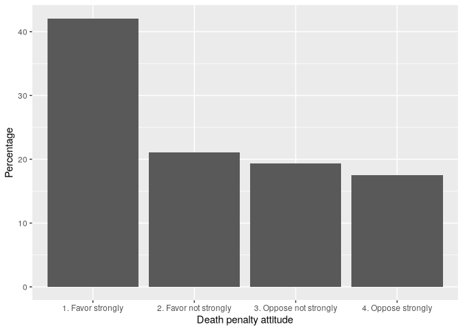
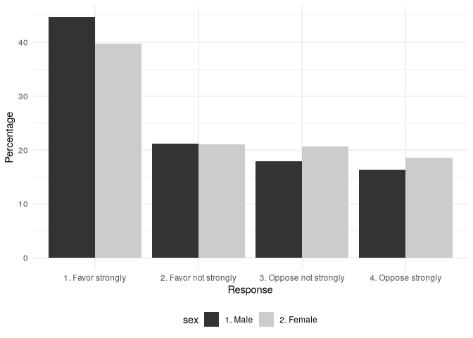
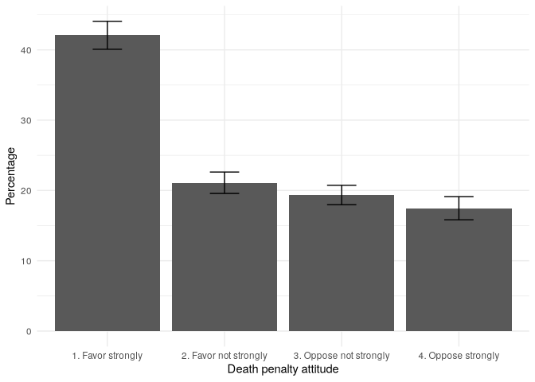
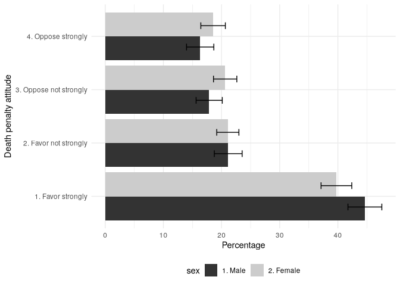
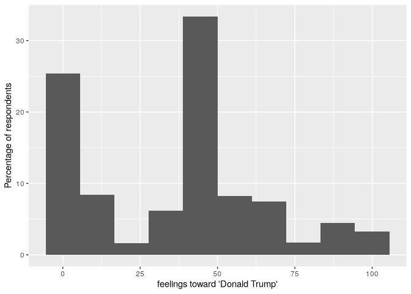

# Analyzing Election Studies


``` r
options(paged.print = F, digits = 4)
```

``` r
library(tidyverse)
library(collapse)
library(magrittr)
library(survey)
```

[Variable
table](https://sda.berkeley.edu/sdaweb/docs/nes2020full/DOC/hcbkx01.htm)
[Source](https://whittkilburn.github.io/inpolr/ch9.html)
[ANES](https://electionstudies.org/data-center/2020-time-series-study/)

# Election polling

The example of Dewey’s loss to Truman, despite the polls.

The ANES survey developed a more representative sample than the quota
sampling methods used before. The survey involved pre-election and
post-election polling, including, views on policy issues and demogrphic
background.

In the pre-election survey, respondents were asked whether they intended
to vote in the presidential election and the party of their vote choice.
Among likely voters, 47.09 percent chose the Democratic party and 49.24
percent Republican. The survey showed Dewey with more support than
Truman, well within the survey’s 3.8 percent margin of error, making the
election too close to call. Given the candidate centered focus of
American politics, even as early as 1948 a survey question asking about
party support would have been a fuzzy indicator of vote choice. In the
post-election survey, respondents were asked for which candidate they
voted back in November. Among likely voters, 50.2 percent of respondents
reported voting for Truman and 42.2 percent for Dewey. While
under-counting Dewey’s support, support for Truman differed by less than
a percentage point, just barely exceeding the margin of error. The ANES
could have called the election correctly.

We will: - tabulate survey responses - construct cross-tabulations
(contingency tables), a fundamental tool for exploring associations
between two categorical measures - calculate sample means and
proportions. - account for likely ranges of population-level
characteristics given the ANES sample - test the sample against
hypothetical population values - create data visualizations commonly
used in the study of public opinion. Prior to analyzing the 2020 ANES
data, however, we first need to become familiar with basic aspects of
national election poll sampling.

## Sampling a national electorate

Methods include 3 key components.

1.  Sampling within strata - dividing the country into geographic or
    demographic regions
2.  Clustering interviews - within each stratum, interviews clustered in
    specific areas to reduce cost; increased uncertainty must be
    accounted for
3.  Observation weights applied to correct for unequal probabilies of
    selection and over or under representation of groups

## The 2020 ANES survey

``` r
load("data/anes 2020 survey data.rdata")
```

``` r
library(haven)
anes_stata <- haven::read_dta("data/anes/anes_timeseries_2020_stata_20220210.dta")
str(anes_stata$V200005)
```

     dbl+lbl [1:8280] 0, 0, 0, 0, 1, 0, 0, 0, 0, 1, 0, 0, 1, 0, 0, 0, 0, 0, 0, ...
     @ label       : chr "Case validation: eligibility concerns"
     @ format.stata: chr "%12.0g"
     @ labels      : Named num [1:4] 0 1 2 3
      ..- attr(*, "names")= chr [1:4] "0. No special concern" "1. Some concern (possible substitution)" "2. High concern (likely substitution)" "3. Highest concern (evident substitution)"

``` r
names(anes_20)
```

      [1] "version"      "V200001"      "V200015b"     "V200015c"     "V200015d"    
      [6] "V201005"      "V201006"      "V201020"      "V201033"      "V201100"     
     [11] "V201115"      "V201116"      "V201118"      "V201119"      "V201126x"    
     [16] "V201129x"     "V201151"      "V201152"      "V201153"      "V201154"     
     [21] "V201200"      "V201225x"     "V201228"      "V201231x"     "V201232"     
     [26] "V201234"      "V201235"      "V201236"      "V201237"      "V201240"     
     [31] "V201241"      "V201244"      "V201246"      "V201249"      "V201247"     
     [36] "V201248"      "V201250"      "V201251"      "V201305x"     "V201308x"    
     [41] "V201327x"     "V201330x"     "V201336"      "V201345x"     "V201346"     
     [46] "V201349x"     "V201350"      "V201352"      "V201353"      "V201356x"    
     [51] "V201359x"     "V201372x"     "V201375x"     "V201411x"     "V201414x"    
     [56] "V201415"      "V201416"      "V201423x"     "V201426x"     "V201433"     
     [61] "V201434"      "V201452"      "V201453"      "V201456"      "V201458x"    
     [66] "relig_trad"   "secular"      "attend"       "V201502"      "V201507x"    
     [71] "V201508"      "V201511x"     "V201549x"     "V201600"      "V201628"     
     [76] "V201645"      "V201646"      "V201647"      "V202471"      "V202013"     
     [81] "V202014"      "V202015"      "V202016"      "V202017"      "V202019"     
     [86] "V202021"      "V202022"      "V202023"      "V202072"      "V202073"     
     [91] "V202156"      "V202157"      "V202158"      "V202159"      "V202160"     
     [96] "V202161"      "V202162"      "V202163"      "V202164"      "V202165"     
    [101] "V202166"      "V202167"      "V202168"      "V202169"      "V202170"     
    [106] "V202171"      "V202172"      "V202173"      "V202174"      "V202175"     
    [111] "V202176"      "V202177"      "V202178"      "V202179"      "V202180"     
    [116] "V202181"      "V202182"      "V202183"      "V202184"      "V202185"     
    [121] "V202186"      "V202187"      "V202225"      "V202231x"     "V202232"     
    [126] "V202233"      "V202236x"     "V202239x"     "V202242x"     "V202245x"    
    [131] "V202248x"     "V202259x"     "V202260"      "V202261"      "V202262"     
    [136] "V202263"      "egal_index"   "V202264"      "V202265"      "V202266"     
    [141] "V202267"      "V202268"      "V202269"      "auth_index"   "V202286x"    
    [146] "V202290x"     "V202291"      "V202292"      "sexism_index" "V202300"     
    [151] "V202301"      "V202302"      "V202303"      "V202304"      "V202305"     
    [156] "V202308x"     "V202309"      "V202310"      "V202311"      "V202312"     
    [161] "V202313"      "V202314"      "V202315"      "V202316"      "V202325"     
    [166] "V202331x"     "V202341x"     "V202344x"     "V202351"      "V202355"     
    [171] "V202361x"     "V202367x"     "V202373x"     "V202376x"     "V202377"     
    [176] "V202383x"     "V202387x"     "V202390x"     "V202456"      "V202562"     
    [181] "V202475"      "V202541a"     "V202541b"     "V202541c"     "V202541d"    
    [186] "V202541e"     "V202541f"     "V202541g"     "V202559"      "V202410"     
    [191] "V202411"      "V202412"      "V202413"      "V202414"      "V201377"     

For example, the sixth variable V201005. In the codebook following the
name is a variable label, which explains that the subject matter of the
question is “How often does \[respondent\] pay attention to politics and
elections”. In the second section of the codebook the exact wording of
the survey question is “How often do you pay attention to what’s going
on in government and politics?”

The results show the (unweighted) frequencies. Variables can be factors
or numeric.

``` r
str(anes_20$V201005)
```

     Factor w/ 5 levels "1. Always","2. Most of the time",..: 3 2 3 3 4 4 2 4 3 1 ...

``` r
summary(anes_20$V201005)
```

                 1. Always    2. Most of the time 3. About half the time 
                      1158                   1863                    920 
       4. Some of the time               5. Never 
                       795                     47 

Variables stored in the numeric storage type are purely numeric scores
without a verbal label attached, such as age or a feeling thermometer
score. Variable V202162 records feelings toward labor unions.

``` r
str(anes_20$V202162)
```

     num [1:4783] 0 50 50 70 50 15 60 100 50 40 ...

``` r
summary(anes_20$V202162)
```

       Min. 1st Qu.  Median    Mean 3rd Qu.    Max.     NAs 
        0.0    50.0    60.0    58.7    70.0   100.0      88 

Factors can be treated as numeric

``` r
summary(as.numeric(anes_20$V201005))
```

       Min. 1st Qu.  Median    Mean 3rd Qu.    Max. 
       1.00    2.00    2.00    2.31    3.00    5.00 

# Specifying a survey sample design

To account for the complex survey design, analyses must adjust for the
three key elements: strata, clusters, and weights.

V200015a All fresh sample (excludes 2016) pre-election weight V200015b
All fresh sample (excludes 2016) post-election weight V200015c All fresh
sample (excludes 2016) variance unit V200015d All fresh sample (excludes
2016) variance stratum

For the 2020 ANES survey data, the sample design is specified as
follows:

``` r
anes2020 <- svydesign(data = anes_20, strata = ~V200015d,
                      ids = ~V200015c, weights = ~V200015b, nest = T)
```

# Tabulating and cross-tabulating survey measures

The svytable() function tabulates the weighted frequencies for a
variable, such as V201005. Two arguments are required: the variable to
tabulate and the survey design object.

``` r
svytable(~V201005, anes2020, round = T)
```

    V201005
                 1. Always    2. Most of the time 3. About half the time 
                      1004                   1713                    986 
       4. Some of the time               5. Never 
                      1027                     54 

``` r
(table1 <- prop.table(svytable(~V201005, anes2020, round = T)) * 100)
```

    V201005
                 1. Always    2. Most of the time 3. About half the time 
                    20.987                 35.807                 20.610 
       4. Some of the time               5. Never 
                    21.467                  1.129 

## Cross-tabulation (contingency) tables

Tabluate by sex (V201600).

``` r
svytable(~ V201005 + V201600, anes2020, round = T)
```

                            V201600
    V201005                  -9. Refused 1. Male 2. Female
      1. Always                        6     568       429
      2. Most of the time              6     856       851
      3. About half the time           7     384       594
      4. Some of the time              4     454       569
      5. Never                         0      28        26

## Creating and recoding a new survey measure

Create a new sex variable with “Refused” changed to `NA`.

``` r
anes_20 %<>% fmutate(sex = V201600)
```

``` r
anes_20 %<>% 
  fmutate(sex = fct_recode(V201600, NULL = "-9. Refused"))
```

One important step in analyzing data with the survey package is that
each time a new variable is created, the svydesign() function must be
run again, so that the names of the new variables are stored within the
svydesign() object.

``` r
make_anes_survey <- function() svydesign(data = anes_20, ids = ~V200015c,
            strata = ~V200015d, weights = ~V200015b, nest = T)
anes2020 <- 
  svydesign(data = anes_20, ids = ~V200015c,
            strata = ~V200015d, weights = ~V200015b, nest = T)
```

``` r
svytable(~V201005 + sex, anes2020, round = T)
```

                            sex
    V201005                  1. Male 2. Female
      1. Always                  568       429
      2. Most of the time        856       851
      3. About half the time     384       594
      4. Some of the time        454       569
      5. Never                    28        26

## Column and row proportions in a contingency table

Column proportions

``` r
svytable(~V201005 + sex, anes2020, round = T) %>% prop.table(margin = 2)
```

                            sex
    V201005                  1. Male 2. Female
      1. Always              0.24803   0.17375
      2. Most of the time    0.37380   0.34467
      3. About half the time 0.16769   0.24058
      4. Some of the time    0.19825   0.23046
      5. Never               0.01223   0.01053

The table appears to show an association between sex and interest.

# Test of independence for contingency tables

The Chi-squared test of independence can be used to determine if the
association is statistically significant.

``` r
svychisq(~V201005 + sex, anes2020)
```


        Pearson's X^2: Rao & Scott adjustment

    data:  svychisq(~V201005 + sex, anes2020)
    F = 8.4, ndf = 3.7, ddf = 187.2, p-value = 5e-06

The association is statistically significant

## Contingency tables controlling for a third factor

In a contingency table we could observe that two measures are related (a
y covarying with x), but the possibility remains that the relationship
is spurious — any observed association in the relationship between x and
y could be the result of a third variable z that influences both. To
test the extent to which the relationship within a contingency table
persists when controlling for a third factor, we subset the data on
values of the third factor and recalculate the contingency table.

To demonstrate, we will cross-tabulate party identification by religious
service attendance, then on levels of sex, to observe whether there is
evidence — controlling for sex — that Democrats report less religiosity
than Republicans.

## Recoding for a table of party identification by religiosity

The two relevant variables from the survey are V201228 for party
identification, and for religious service attendance the variable
attend, constructed from V201452 and V201453.

``` r
anes_20 %<>%
  fmutate(
    partyid = fct_recode(V201228,
      "3. Independent" = "-9. Refused",
      "3. Independent" = "-8. Don't know",
      "3. Independent" = "0. No preference {VOL - video/phone only}",
      NULL = "5. Other party {SPECIFY}"
    ),
    partyid = fct_relevel(
      partyid, "1. Democrat", "2. Republican",
      "3. Independent"
    )
  )
```

Creating a measure that summarizes a survey respondent’s attendance at
religious services requires combining responses from two different
survey questions. First, respondents are asked whether they attend
religious services at all:

``` r
table(anes_20$V201452)
```


       -9. Refused -8. Don't know         1. Yes          2. No 
                30              2           2266           2485 

Then if they respond “Yes”, they are asked how frequently:

``` r
table(anes_20$V201453)
```


                 -9. Refused           -8. Don't know            1. Every week 
                          11                        1                      727 
        2. Almost every week 3. Once or twice a month    4. A few times a year 
                         528                      375                      565 
                    5. Never 
                          59 

``` r
anes_20 %<>%
  fmutate(attend = case_when(
    V201452 == "2. No" ~ "1. Never",
    V201453 == "5. Never" ~ "1. Never",
    V201453 == "4. A few times a year" ~ "2. A few times a year",
    V201453 == "3. Once or twice a month" ~ "3. Once or twice a month",
    V201453 == "2. Almost every week" ~ "4. Almost every week",
    V201453 == "1. Every week" ~ "5. Every week"))
```

``` r
table(anes_20$attend)
```


                    1. Never    2. A few times a year 3. Once or twice a month 
                        2544                      565                      375 
        4. Almost every week            5. Every week 
                         528                      727 

Combine 2 and three:

``` r
anes_20 %<>%
  fmutate(attend = fct_recode(attend,
        "2. few times a year, monthly" = "2. A few times a year",
        "2. few times a year, monthly" = "3. Once or twice a month",
        "3. almost every week" = "4. Almost every week",
        "4. every week" = "5. Every week"))
```

``` r
anes2020 <- make_anes_survey()
```

``` r
prop.table(svytable(~ partyid + attend, design = anes2020, round = T),
           margin = 2)
```

                    attend
    partyid          1. Never 2. few times a year, monthly 3. almost every week
      1. Democrat      0.3612                       0.3755               0.2711
      2. Republican    0.2311                       0.3521               0.4719
      3. Independent   0.4077                       0.2723               0.2570
                    attend
    partyid          4. every week
      1. Democrat           0.2576
      2. Republican         0.4970
      3. Independent        0.2455

Yet given the possibility that these relationships break down when
controlling for sex, we recreate the cross-tabulation on each value of
the sex variable. In constructing control tables such as these, the goal
is to test whether any observed relationship between the independent and
dependent variable persists for each level of the control variable. If
the relationship between party identification and religious service
attendance appears at least somewhat null across levels of sex (1. Male
and 2.Female), then this pattern would be evidence of spuriousness. Of
course, it is unlikely that sex would be a source of spuriousness; it is
much more likely that we would observe sex as an additive effect
shifting party identification and religious attendance in a particular
direction.

``` r
svytable(~ partyid + attend, subset(anes2020, sex == "1. Male"), round = T) %>% 
  prop.table(margin = 2)
```

                    attend
    partyid          1. Never 2. few times a year, monthly 3. almost every week
      1. Democrat      0.3054                       0.3744               0.1435
      2. Republican    0.2557                       0.3412               0.5740
      3. Independent   0.4389                       0.2844               0.2825
                    attend
    partyid          4. every week
      1. Democrat           0.2500
      2. Republican         0.5449
      3. Independent        0.2051

``` r
svytable(~ partyid + attend, subset(anes2020, sex == "2. Female"), round = T) %>% 
  prop.table(margin = 2)
```

                    attend
    partyid          1. Never 2. few times a year, monthly 3. almost every week
      1. Democrat      0.4184                       0.3779               0.3759
      2. Republican    0.2072                       0.3605               0.3905
      3. Independent   0.3744                       0.2616               0.2336
                    attend
    partyid          4. every week
      1. Democrat           0.2651
      2. Republican         0.4524
      3. Independent        0.2824

``` r
svychisq(~ partyid + attend, subset(anes2020, sex == "2. Female"), round = T)
```


        Pearson's X^2: Rao & Scott adjustment

    data:  svychisq(~partyid + attend, subset(anes2020, sex == "2. Female"),     round = T)
    F = 11, ndf = 5.2, ddf = 261.6, p-value = 1e-09

Among males and females, the gap between Democrats and Republicans among
those reporting that they “Never” attend services is about 5 and 21
percent, respectively. Among those attending services weekly, the gap
between Republicans and Democrats is 29 and 18 percent. Rather than
being a source of spuriousness, sex is better described as an additive
factor — pushing up Republican party identity among males and Democratic
party identity among females. Notice that among non-attendees, 41.84
percent of females identify as Democrats, an 11 percent gap compared to
males, while only 45.24 percent of females attending services weekly
identify as Republican, a similar gap compared to males.

# Confidence intervals and tests on proportions and means

The function confint() calculates, by default, 95 percent confidence
intervals. For a variable stored as a factor, with ordered or nominal
categories, the svymean() function calculates the proportions based on a
mean (from each category scaled to a value of 1), and wrapped within
confint() reports the lower and upper bounds of a confidence interval.
Because there are missing values recorded for some respondents, the
argument na.rm=TRUE is necessary

``` r
confint(svymean(~ partyid, anes2020, na.rm = T))
```

                           2.5 % 97.5 %
    partyid1. Democrat    0.3183 0.3591
    partyid2. Republican  0.3014 0.3372
    partyid3. Independent 0.3245 0.3595

With a 95% confidence level we can say that between 32% and 36% identify
as Democrat.

The same functions applied to a numeric variable results in a mean and
confidence interval on the underlying scale. For example, the feeling
thermometer for the “U.S. Supreme Court” ranges from 0 to 100.

``` r
svymean(~V202165, anes2020, na.rm = T)
```

            mean  SE
    V202165 59.5 0.5

``` r
svymean(~V202165, anes2020, na.rm = T) %>% confint
```

            2.5 % 97.5 %
    V202165 58.51  60.49

Mean feeling toward court is between 58.5 and 60.5 degrees.

## Tables of means for levels of a categorical variable

The `svyby()` function can be combined with svymean() to calculate a
table of means on a categorical (factor) variable. For example, we could
create age groups based on the survey question V201507x recording the
survey respondent’s age, and compare feeling thermometer scores across
age groups. Feelings toward “transgender people” is recorded in variable
V202172.

``` r
anes_20 %<>%
  fmutate(agecat = case_when(
    V201507x %in% 15:29 ~ "18 to 29",
    V201507x %in% 30:49 ~ "30 to 49",
    V201507x %in% 50:59 ~ "50 to 59",
    V201507x %in% 60:100 ~ "60 and above"
  )) %>%
  fmutate(
    agecat = as_factor(agecat),
    agecat = fct_relevel(
      agecat, "18 to 29",
      "30 to 49", "50 to 59", "60 and above"
    )
  )
```

``` r
table(anes_20$agecat)
```


        18 to 29     30 to 49     50 to 59 60 and above 
             631         1478          749         1716 

``` r
anes2020 <- make_anes_survey()
svyby(~V202172, ~agecat, anes2020, svymean, na.rm = T)
```

                       agecat V202172     se
    18 to 29         18 to 29   66.24 1.6865
    30 to 49         30 to 49   59.92 0.8281
    50 to 59         50 to 59   56.35 1.1294
    60 and above 60 and above   55.16 0.9076

Among 18- to 29-year-olds, the sample mean feeling toward transgender
people is 66.24 degrees, and among those 60 and above 55.16 degrees.

Confidence intervals

``` r
svyby(~V202172, ~agecat, anes2020, svymean, na.rm = T) %>% confint
```

                 2.5 % 97.5 %
    18 to 29     62.93  69.54
    30 to 49     58.30  61.55
    50 to 59     54.13  58.56
    60 and above 53.38  56.93

## Hypothesis tests on means

T-tests with `svyttest()`. For example, we may be interested in testing
whether there is evidence of population-based differences, by gender, in
feeling thermometer scores. One approach would be to calculate and
compare 95 percent confidence intervals. Another is to directly test the
hypothesis that the mean feeling differs across groups, a two-sample
test. To compare, for example, feelings toward the “Me too movement”
(feeling thermometer V202183), the svytest() function argument is the
feeling thermometer V202183 by sex:

``` r
svyttest(V202183 ~ sex, anes2020, na.rm = T)
```


        Design-based t-test

    data:  V202183 ~ sex
    t = 7.7, df = 49, p-value = 6e-10
    alternative hypothesis: true difference in mean is not equal to 0
    95 percent confidence interval:
      7.74 13.24
    sample estimates:
    difference in mean 
                 10.49 

Very low p-value, with 95% confidence, the difference is between 7.74
and 13.24.

# Data visualization for polls

``` r
table1 <- svytable(~V201345x, anes2020, round = T) %>% 
  prop.table() * 100
table1 %<>% as.data.frame()
colnames(table1) <- c("Response", "Percentage")
```

``` r
ggplot(table1, aes(x = Response, y = Percentage)) +
  geom_bar(stat = "identity") +
  labs(x = "Death penalty attitude", y = "Percentage")
```



To contrast death penalty support by respondent sex, we construct the
cross-tabulation and save it as a dataframe

``` r
table2 <- prop.table(svytable(~ V201345x + sex, anes2020, round = TRUE),
  margin = 2
) * 100
table2 <- as.data.frame(table2)
colnames(table2) <- c("Response", "sex", "Percentage")
```

``` r
ggplot(table2, aes(x = Response, y = Percentage, fill = sex)) +
  geom_bar(stat = "identity", position = "dodge") +
  labs(x = "Response", y = "Percentage") +
  theme_minimal() +
  theme(legend.position = "bottom") +
  scale_fill_grey()
```



## Bar graph with error bars

``` r
(error_table1 <- svymean(~V201345x, anes2020, na.rm = TRUE) %>% 
   as.data.frame())
```

                                     mean       SE
    V201345x1. Favor strongly      0.4206 0.010141
    V201345x2. Favor not strongly  0.2110 0.007772
    V201345x3. Oppose not strongly 0.1936 0.007045
    V201345x4. Oppose strongly     0.1747 0.008413

``` r
table1 %<>% cbind(error_table1)
```

``` r
settransform(table1, error = (1.96 * SE) * 100)
row.names(table1) <- NULL
table1
```

                    Response Percentage   mean       SE error
    1      1. Favor strongly      42.07 0.4206 0.010141 1.988
    2  2. Favor not strongly      21.10 0.2110 0.007772 1.523
    3 3. Oppose not strongly      19.35 0.1936 0.007045 1.381
    4     4. Oppose strongly      17.48 0.1747 0.008413 1.649

``` r
ggplot(table1, aes(x = Response, y = Percentage)) +
  geom_bar(stat = "identity") +
  labs(x = "Death penalty attitude", y = "Percentage") +
  geom_errorbar(aes(ymin = Percentage - error, ymax = Percentage + error),
    width = 0.25
  ) +
  theme(legend.position = "bottom") +
  theme_minimal()
```



``` r
table2_m <- svymean(~V201345x, subset(anes2020, sex == "1. Male"),
  round = TRUE, na.rm = TRUE
) %>% as.data.frame() * 100

table2_f <- svymean(~V201345x, subset(anes2020, sex == "2. Female"),
  round = TRUE, na.rm = TRUE) %>% as.data.frame() * 100

table2_both <- rbind(table2_m, table2_f)
table2<-cbind(table2, table2_both)
table2 %<>%
  mutate(error = (1.96*SE))
```

``` r
ggplot(table2, aes(x = Response, y = Percentage, fill=sex)) +
  geom_bar(stat = "identity", position="dodge") +
  labs(x = "Death penalty attitude", y = "Percentage") +
  geom_errorbar(aes(ymin = Percentage - error,
                    ymax = Percentage + error),
      position = position_dodge(width = 0.8), width = 0.25) +
  coord_flip() +
  theme_minimal() +
  theme(legend.position = "bottom") +
  scale_fill_grey()
```



## Weighted histograms

``` r
ggplot(anes_20) +
  geom_histogram(aes(
    x = V202179, y = after_stat(width * density) * 100,
    weight = V200015b
  ), bins = 10) +
  labs(
    x = "feelings toward 'Donald Trump'",
    y = "Percentage of respondents"
  )
```

    Warning: Removed 458 rows containing non-finite outside the scale range
    (`stat_bin()`).


