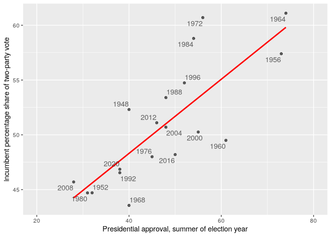
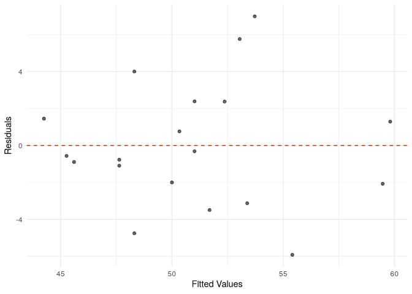
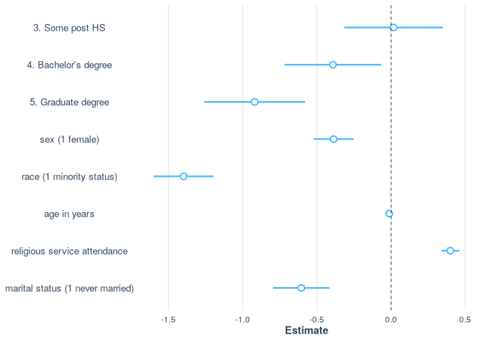

# Linear Models


``` r
options(paged.print = F, digits = 4)
```

``` r
library(tidyverse)
library(collapse)
library(magrittr)
library(ggrepel)
library(survey)
library(memisc)
library(jtools)
fread <- data.table::fread
```

# Simple linear model of election fundamentals

In Chapter 10 we review the fundamentals-based model of US presidential
elections, starting with the incumbent president’s share of the
Democratic plus Republican popular vote as related to presidential
approval. Then from there we examine the model in full.

``` r
prez <- fread("data/prez.csv")
head(prez)
```

                   candidates    incprez approval  year qgdprate incstatus  vote
                       <char>     <char>    <int> <int>    <num>     <int> <num>
    1:         truman_v_dewey     truman       40  1948      1.7         0 52.31
    2: stevenson_v_eisenhower     truman       32  1952      0.2         1 44.71
    3: eisenhower_v_stevenson eisenhower       73  1956      0.8         0 57.40
    4:        nixon_v_kennedy eisenhower       61  1960     -0.5         1 49.50
    5:    johnson_v_goldwater    johnson       74  1964      1.1         0 61.10
    6:       humphrey_v_nixon    johnson       40  1968      1.7         1 43.56

``` r
ggplot(prez, aes(x = approval, y = vote)) +
  stat_smooth(method = "lm", se = F, color = "red") +
  geom_point(alpha = 0.6, show.legend = F) +
  geom_text_repel(aes(label = year), alpha = 0.6) +
  scale_x_continuous(limits = c(20, 80)) +
  labs(
    y = "incumbent percentage share of two-party vote",
    x = "Presidential approval, summer of election year"
  ) +
  theme(legend.position = "bottom")
```

    `geom_smooth()` using formula = 'y ~ x'



``` r
lm(vote ~ approval, data = prez)
```


    Call:
    lm(formula = vote ~ approval, data = prez)

    Coefficients:
    (Intercept)     approval  
         34.781        0.338  

The line equation in the figure is $Y=34.78+0.338X$. For each one-unit
change in approval percentage, on average, the incumbent’s share of the
two-party vote changes by about a third of a percentage point. So it
takes about a three-point change in approval to move the incumbent vote
share by one point.

## Correlation and simple linear regression

Pearson correlation coefficient, using the $z$-scores:

$$r = \frac{\sum z_x z_y}{N}$$
With sample data, the denominator is $N-1$. `cor` uses this as a
default.

``` r
cor(prez$vote, prez$approval)
```

    [1] 0.788

``` r
sum(scale(prez$vote) * scale(prez$approval)) / (length(prez$vote) - 1)
```

    [1] 0.788

$Y = a + bX$ is related to $r$ through $b = r \frac{s_Y}{s_X}$, where
$s_X$ and $s_Y$ are standard deviations.

``` r
cor(prez$vote, prez$approval) * sd(prez$vote) / sd(prez$approval)
```

    [1] 0.3382

which matches the slope.

## Line of best fit

Minimize the sum of squared residuals, $\sum (y_i - \hat{y}_i)^2$.

# Evaluating fit

## RMSE

$$Root\ mean\ square\ error\ (RMSE)=\sqrt{\frac{\sum(y_i−\hat{y}_i)^2}{N}}$$

``` r
model1 <- lm(vote ~ approval, data = prez)
residuals <- model1$residuals
(rmse <- sqrt(mean(residuals^2)))
```

    [1] 3.279

On average, the predictions made by the model are off by about 3.279
percentage points from the actual values.

## R-squared

Three quantities are defined:

1.  ESS (Error Sum of Squares) $\sum(y_i-\hat{y}_i)^2$: squared
    residuals
2.  TSS (Total Sum of Squares) $\sum(y_i-\bar{y})^2$: differences
    between observed values and the mean
3.  RSS (Regression Model Sum of Squares) $\sum(\hat{y}_i - \bar{y})$ -
    differences between the predicted values and the mean

$ESS + RSS = TSS$. RSS quantifies how much better the regression model’s
predictions are compared to simply using the mean. The ESS represents
the unexplained variation. The ratio $\frac{RSS}{TSS}$ is the proportion
of the total varation in $Y$ accounted for by predictor $X$.

$R^2=\frac{RSS}{TSS} = 1 - \frac{ESS}{TSS}$

``` r
total_squares <- (prez$vote - mean(prez$vote))^2
(TSS <- sum(total_squares))
```

    [1] 538.8

``` r
(RSS = sum((model1$fitted.values - mean(prez$vote))^2))
```

    [1] 334.6

``` r
(ESS <- sum(model1$residuals^2))
```

    [1] 204.2

``` r
(RSS / TSS)
```

    [1] 0.6209

``` r
summary(model1)$r.sq
```

    [1] 0.6209

About 62 percent of the variance in the dependent variable (vote) is
explained by the independent variable (approval). Since R2 is a
proportion between 0 and 1, an R2 of .62 suggests that the model does a
reasonably good job of accounting for variability in incumbent party
vote share. Nonetheless, about 38 percent of the variance is not
explained by the model.

## Residuals and fitted values

``` r
ggplot(prez, aes(x = model1$fitted.values, y = model1$residuals)) +
  geom_point(alpha = 0.6 ) +
  geom_hline(yintercept = 0, linetype = "dashed", color = "red") +
  labs(x = "Fitted Values", y = "Residuals") +
  theme_minimal()
```



In any plot of residuals versus fitted values, there are two general
trends to look for along the fitted values:

1.  the mean of residuals (marked in this graphic by the horizontal
    line) should be roughly 0. If it is, then the assumption underlying
    the model that the relationship between X and Y is linear, holds.
2.  the spread of the residuals should be roughly the same. This pattern
    is important, because if the spread differs, such as there being
    higher spread at higher ends of the fitted values, then the model
    fit is problematic.

# Multiple linear model of election fundamentals

By expanding the number of independent variables $X$ from one to three:
$X_1$ election year summer presidential approval; $X_2$ Q2 election year
GDP growth; and $X_3$ whether the incumbent president’s party has held
the White House for one or more than one term — we assess the
simultaneous influence of these factors on vote share.

``` r
model2 <- lm(vote ~ approval + qgdprate + incstatus, data = prez)
summary(model2)$r.sq
```

    [1] 0.8162

# Population regression model

Assumptions:

1.  The relationship between $X$ and $Y$ is linear throughout $X$,
    allowing it to be expressed as $Y=a+B_1X_1+...+B_kX_k+e$, with $e$
    as the error term
2.  There are no omitted independent variables. The error term $e$ must
    be independent and uncorrelated with $X$.
3.  The errors have a mean of 0
4.  The errors are independent across observations. One observation’s
    error does not influence another.
5.  The variation in errors is constant across $X$ (homoskedasticity)
6.  The errors follow a normal distribution

## Models and election surveys

To illustrate the basic concepts involved in interpreting regression
model estimates in light of the population regression model, we develop
a simple regression model. Specifically, we examine party identification
as the dependent variable, modeled as a function of religious service
attendance as the independent variable:

$$Y=a+B∗attendance+e$$

Party identification is a 7 point ordinal scale, but is treated as
continuous for regression analysis. Residual diagnostics evaluate
whether this is appropriate.

Specifically, we will test whether the slope for religious service
attendance is effectively zero in the population, indicating no
relationship between attendance and party identification.

## Linear models with 2020 ANES

``` r
load("data/anes 2020 survey data.rdata")
```

``` r
anes_20 %<>%
  fmutate(partyid7pt = fct_recode(V201231x,
                                  NULL = "-9. Refused",
                                  NULL = "-8. Don't know"),
          partyid_num = as.numeric(partyid7pt),
          attend_num = as.numeric(attend))
```

``` r
(regmodel <- lm(partyid_num ~ attend_num, weight = V200015b, data = anes_20))
```


    Call:
    lm(formula = partyid_num ~ attend_num, data = anes_20, weights = V200015b)

    Coefficients:
    (Intercept)   attend_num  
          3.213        0.388  

``` r
summary(regmodel)
```


    Call:
    lm(formula = partyid_num ~ attend_num, data = anes_20, weights = V200015b)

    Weighted Residuals:
       Min     1Q Median     3Q    Max 
    -8.772 -1.592  0.008  1.567  8.487 

    Coefficients:
                Estimate Std. Error t value Pr(>|t|)    
    (Intercept)   3.2127     0.0615    52.2   <2e-16 ***
    attend_num    0.3877     0.0286    13.6   <2e-16 ***
    ---
    Signif. codes:  0 '***' 0.001 '**' 0.01 '*' 0.05 '.' 0.1 ' ' 1

    Residual standard error: 2.16 on 4723 degrees of freedom
      (58 observations deleted due to missingness)
    Multiple R-squared:  0.0376,    Adjusted R-squared:  0.0374 
    F-statistic:  184 on 1 and 4723 DF,  p-value: <2e-16

Weighted Residuals: a median near 8 and symmetry suggest a good fit

Results suggest that there is a significant, though very modest,
association between party identification and religious service
attendance.

## Measuring uncertainty of the population parameters

$$SE_b=\frac{s}{\sqrt{\sum(x_i−\bar{x})^2}}$$

Where $s=\sqrt{\frac{ESS}{n-2}}$. The degrees of freedom are penalized
for the y intercept and slope estimated in the model.

From the formula, the size of the standard error depends on three main
factors:

1.  Smaller residuals s. Less variability around the regression line
    results in a smaller standard error, improving the precision of the
    slope estimate.
2.  Spread of the independent variable ∑(xi−¯x). A wider spread of
    values in X increases the denominator, decreasing the standard
    error.
3.  Sample size n. Larger sample sizes reduce the residual variability s
    reducing the standard error.

The t value, from the Student’s t distribution, is the ratio of the
sample slope to its standard error, $t=\frac{b}{SE}$. In this case
$t=\frac{.3877}{.0286}=13.6$. For large sample sizes, the t-distribution
closely approximates a normal z-distribution.

## Correcting for sample design in ANES

The `weights` argument in `lm` does not correct the standard errors for
the complex survey design. Therefor, `survey` must be used.

``` r
make_survey <- function() svydesign(data = anes_20, ids = ~V200015c,
                    strata=~V200015d, weights=~V200015b, nest=TRUE)
anes2020_design <- make_survey()
```

``` r
regmodel2 <- svyglm(as.numeric(partyid7pt) ~ attend_num,
                    design = anes2020_design)
summary(regmodel2)
```


    Call:
    svyglm(formula = as.numeric(partyid7pt) ~ attend_num, design = anes2020_design)

    Survey design:
    svydesign(data = anes_20, ids = ~V200015c, strata = ~V200015d, 
        weights = ~V200015b, nest = TRUE)

    Coefficients:
                Estimate Std. Error t value Pr(>|t|)    
    (Intercept)   3.2127     0.0730    44.0  < 2e-16 ***
    attend_num    0.3877     0.0349    11.1  5.2e-15 ***
    ---
    Signif. codes:  0 '***' 0.001 '**' 0.01 '*' 0.05 '.' 0.1 ' ' 1

    (Dispersion parameter for gaussian family taken to be 4.677)

    Number of Fisher Scoring iterations: 2

The Estimates are the same, but the Std. Error is different.

## Numeric vs. ordinal or categorical measures

When an independent variable is stored as a factor, both lm() and
svyglm() automatically create a series of dichotomous (0 or 1) variables
for each level of the factor, leaving one level out as the reference
category.

``` r
regmodel3 <- svyglm(partyid_num ~ attend,
                    design = anes2020_design)
regmodel3$coefficients
```

                         (Intercept) attend2. few times a year, month 
                              3.5878                           0.4050 
          attend3. almost every week              attend4. every week 
                              0.9612                           1.0879 

There is an increase in .4 points on the scale toward Republican
identification compared to never attending.

Whether to treat an ordinal or nominal variable as numeric or as a
factor depends on the theoretical purpose of the variable in the model.
As a control variable, if it is included purely for statistical control
and the specific category level differences are not of theoretical
interest, then it is sufficient to treat it as numeric. As a focal
variable, however, if the goal is to explore the relative differences
between categories or if it makes little sense to assume one constant
slope across the range of categories, it should be treated as a factor.
Consider which category should be the baseline. Use the relevel()
function to set a different baseline; to set the baseline as 4. evey
week, use mutate(attend=relevel(attend, ref=“4. every week”)).

# Multiple linear model of party identification

For example, a researcher might hypothesize that formal educational
attainment has a strong relationship with party identification in the
United States, even after accounting for other demographic factors. In
this model, educational attainment will serve as the focal variable,
while other independent variables are included to control for
alternative sources of influence.

The model includes the following independent variables:

- edu: five-point scale of educational attainment, treated as a factor
  with “High school credential” as the baseline reference category
- sex: dichotomous coded as 0 for male and 1 for female
- race_category: dichotomous coded as 0 for White, non-Hispanic, and 1
  for all other racial or ethnic groups
- age: continuous age in years
- attend_num: four-point numeric service attendance scale
- never_married : dichotomous coded as 1 for “Never married” and 0 for
  any other marital status.

``` r
anes_20 %<>%
  fmutate(sex = fct_recode(V201600, NULL = "-9. Refused"),
          race_category = fct_recode(V201549x,
                                     NULL = "-9. Refused",
                                     NULL = "-8. Don't know"),
          race_category = ifelse(race_category == '1. White, non-Hispanic', 0, 1),
          age = V201507x,
          age = na_if(age, -9),
          edu = V201511x,
          edu = fct_recode(edu,
                           NULL = "-9. Refused",
                           NULL = "-8. Don't know"),
          never_married = ifelse(V201508 == "6. Never married", 1, 0)
          )
```

``` r
anes_20 %<>%
  fmutate(
    # edu = relevel(edu, ref = "2. High school credential"),
    edu = fct_recode(edu,
      "1. Less than HS" = "1. Less than high school credential",
      "2. HS cred." = "2. High school credential",
      "3. Some post HS" = "3. Some post-high school, no bachelor's degree",
      "4. Bachelor's degree" = "4. Bachelor's degree",
      "5. Graduate degree" = "5. Graduate degree"
    )
  )
```

``` r
anes2020_design <- make_survey()
```

``` r
regmodel4 <- svyglm(partyid_num ~ edu + sex + race_category +
                      age + attend_num + never_married,
                    design = anes2020_design)
summary(regmodel4)
```


    Call:
    svyglm(formula = partyid_num ~ edu + sex + race_category + age + 
        attend_num + never_married, design = anes2020_design)

    Survey design:
    svydesign(data = anes_20, ids = ~V200015c, strata = ~V200015d, 
        weights = ~V200015b, nest = TRUE)

    Coefficients:
                            Estimate Std. Error t value Pr(>|t|)    
    (Intercept)              4.78583    0.19440   24.62  < 2e-16 ***
    edu2. HS cred.           0.03507    0.17483    0.20     0.84    
    edu3. Some post HS       0.01743    0.16464    0.11     0.92    
    edu4. Bachelor's degree -0.39171    0.16140   -2.43     0.02 *  
    edu5. Graduate degree   -0.91912    0.16854   -5.45  2.6e-06 ***
    sex2. Female            -0.38690    0.06697   -5.78  9.0e-07 ***
    race_category           -1.39717    0.09976  -14.01  < 2e-16 ***
    age                     -0.01182    0.00261   -4.52  5.2e-05 ***
    attend_num               0.39982    0.03046   13.12  2.9e-16 ***
    never_married           -0.60429    0.09479   -6.38  1.3e-07 ***
    ---
    Signif. codes:  0 '***' 0.001 '**' 0.01 '*' 0.05 '.' 0.1 ' ' 1

    (Dispersion parameter for gaussian family taken to be 4.116)

    Number of Fisher Scoring iterations: 2

The y-intercept estimate 4.82 represents the predicted party
identification score (leaning Republican) for a strictly hypothetical
person, male, White non-Hispanic, very low formal education, never
attending services, and married or previously married. Holding all other
variables constant, those with graduate degrees shift .95 units toward
Democratic identification.

The dispersion parameter reported in the `svyglm()` output (e.g., 4.116)
represents the estimated variance of the residuals, and its square root
provides the standard error of the residuals.

## Confidence intervals on model estimates

``` r
confint(regmodel4)
```

                              2.5 %    97.5 %
    (Intercept)              4.3932  5.178437
    edu2. HS cred.          -0.3180  0.388149
    edu3. Some post HS      -0.3151  0.349920
    edu4. Bachelor's degree -0.7177 -0.065754
    edu5. Graduate degree   -1.2595 -0.578742
    sex2. Female            -0.5222 -0.251644
    race_category           -1.5986 -1.195704
    age                     -0.0171 -0.006537
    attend_num               0.3383  0.461339
    never_married           -0.7957 -0.412867

Confidence intervals that do not include zero indicate that the
corresponding predictor is statistically significant (p\<0.05). The
calculation is $\text{slope } \pm (1.96 \times \text{SE})$. For
`never_married`, the lower bound is
$-0.60429 - (1.96 * 0.09479) = -0.7901$

``` r
-.60429 + (1.96 * 0.09479)
```

    [1] -0.4185

This does not match exactly the results from `confint`. No explanation
given.

# Model-based predictions

Since the model is based on sample data, there are two types of
intervals to account for uncertainty in these predictions:

Confidence Intervals: These estimate the range within which the average
party identification score for individuals with specific characteristics
is likely to fall. For example, we might say, “We are 95 percent
confident that the average party identification score for individuals
with these characteristics lies between these values.”

Prediction Intervals: These estimate the range within which the party
identification score for a single individual with given characteristics
is likely to fall. Because this prediction applies to a specific person,
the interval is wider to reflect greater uncertainty.

In most cases, we are more interested in confidence intervals, as they
provide insight into the typical or average party identification for
groups (e.g., “What is the average party identification for women with a
college degree?”).

The `predict()` function requires a data table, one column per
independent variable, the first row reserved for variable names.

``` r
predictiondata <- tribble(
  ~edu, ~sex, ~race_category, ~age, ~attend_num, ~never_married,
  "2. HS cred.", "2. Female", 0, 47.5, 0.853, 0
)
```

``` r
(pred <- predict(regmodel4, predictiondata, interval = "confidence"))
```

      link  SE
    1 4.21 0.1

he average predicted party identification score is 4.21, slightly toward
the Republican side of the seven-point scale. The standard error (0.10)
quantifies the uncertainty of the predicted mean.

``` r
confint(pred)
```

      2.5 % 97.5 %
    1 4.011  4.416

# Describing model estimates in tables and graphs

``` r
regtable4 <- mtable("Model of party identification" = regmodel4,
                    sdigits = 2)
```

    Warning in logLik.svyglm(obj): svyglm not fitted by maximum likelihood.

``` r
print(regtable4)
```


    Calls:
    Model of party identification: svyglm(formula = partyid_num ~ edu + sex + race_category + age + 
        attend_num + never_married, design = anes2020_design)

    ===========================================================
      (Intercept)                                    4.786***  
                                                    (0.194)    
      edu: 2. HS cred./1. Less than HS               0.035     
                                                    (0.175)    
      edu: 3. Some post HS/1. Less than HS           0.017     
                                                    (0.165)    
      edu: 4. Bachelor's degree/1. Less than HS     -0.392*    
                                                    (0.161)    
      edu: 5. Graduate degree/1. Less than HS       -0.919***  
                                                    (0.169)    
      sex: 2. Female/1. Male                        -0.387***  
                                                    (0.067)    
      race_category                                 -1.397***  
                                                    (0.100)    
      age                                           -0.012***  
                                                    (0.003)    
      attend_num                                     0.400***  
                                                    (0.030)    
      never_married                                 -0.604***  
                                                    (0.095)    
    -----------------------------------------------------------
      Log-likelihood                             -9123.06      
      N                                           4455         
    ===========================================================
      Significance: *** = p < 0.001; ** = p < 0.01;   
                    * = p < 0.05  

``` r
plot_summs(regmodel4,
           coefs=c("1. Less than HS diploma"="edu1. Less than HS",
   "3. Some post HS" ="edu3. Some post HS", 
   "4. Bachelor's degree"="edu4. Bachelor's degree", 
   "5. Graduate degree"="edu5. Graduate degree",
   "sex (1 female)"="sex2. Female", 
   "race (1 minority status)" ="race_category",
   "age in years"="age",    
   "religious service attendance"="attend_num",
   "marital status (1 never married)" ="never_married"))
```



# Key steps in regression analysis

When conducting a regression analysis, follow established practices and
draw upon prior literature in the field. Published studies provide
examples of how to specify regression models and insights into how to
measure theoretical concepts in a model. Your model should replicate, as
closely as possible, the approaches in prior studies while addressing
the specific nuances of your data. Keep in mind some key steps:

    Identify the dependent variable: Determine how the dependent variable should be scaled. For continuous measures, interval or ratio scaling is assumed. While ordinal scales like a seven-point party identification scale are often treated as continuous, measures with fewer categories may not meet this assumption and should be treated as categorical.

    Determine causal relationships: The dependent variable is assumed to be an effect of the independent variables, which act as causes. A reversal of this causal arrow — treating an effect as a cause — can severely bias model estimates. Ensure that causal assumptions align with established theory.

    Inspect variables: Use univariate summary statistics and visualizations to explore each variable. Identify skewness or other irregularities that may require transformations. Positive skew, for example, often necessitates a log transformation, while other transformations depend on the context and prior studies.

    Assess linearity: Create scatterplots to assess the relationship between the dependent variable and key independent variables. This helps verify whether the assumption of linearity is reasonable.

    Estimate and interpret the model: Fit the regression model and interpret the slopes for direction, magnitude, and statistical significance.

    Inspect residuals: Check residual plots for signs of nonlinearity, nonconstant error variance, or other deviations that might indicate problems with the model.

    Present results: Prepare at least a well-formatted table summarizing the model estimates. Consider adding a figure to communicate, in a nontechnical way, the results of the model.
