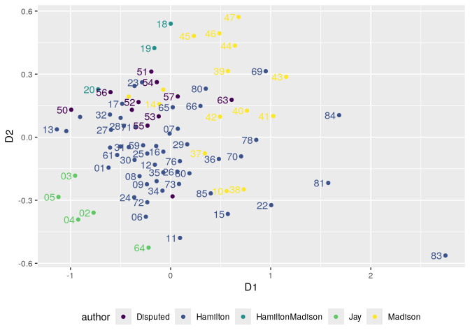
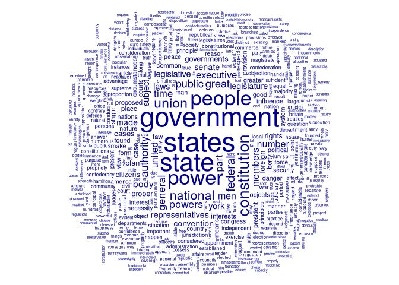
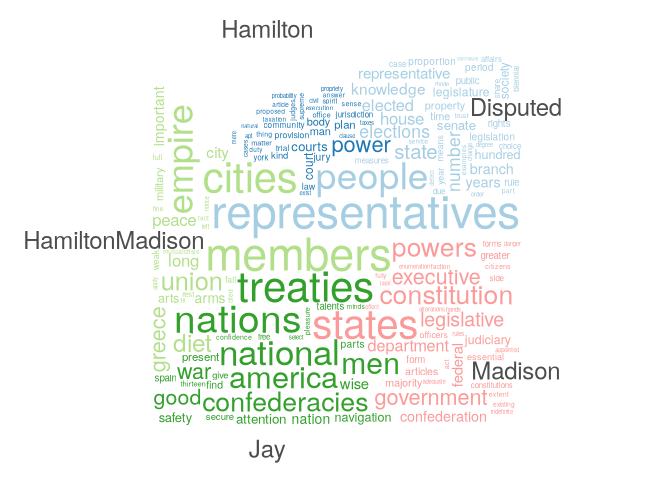

# Patterns in Text as Data


[source](https://whittkilburn.github.io/inpolr/ch8.html)

``` r
options(paged.print = F, digits = 4)
```

# Text as data

Two key distinctions in analyzing text as data shape how researchers
approach their work.

1.  patterns in “function” words

- pronouns, articles, and prepositions (e.g., “they,” “the,” “and,”
  “in”)
- serve as the structural glue that holds sentences together
- often used to explore stylistic features such as style an authorship

2.  patterns in content words

- carry substantive meaning
- include nouns, verbs, adjectives, and adverbs
- for thematic content or topics

Researchers approach these analyses from a “bag of words” or a “strings
as words” approach. - the order of words is disregarded - the
occurrences of words, or co-occurrences across texts, are measured - In
the strings as words approach, the order of words is considered to
assess patterns in their arrangement

The analysis within this chapter begins with The Federalist papers,
applying a bag of words approach to investigate the authorship of the
texts. We will - tokenize the documents - construct matrices of term
frequencies and distances between papers - apply the multidimensional
scaling analysis from Chapter 7 to uncover patterns in authorship.

Then we will shift to methods for uncovering thematic content of The
Federalist and next the content of a bureaucratic regulation proposal
affecting the interpretation of Title IX of US civil rights law.

# Organizing text as data

A commonly used structure is a corpus object. A corpus preserves
metadata and facilitates access to the text for processing. The text is
broken into smaller units called tokens, which are usually words or
phrases, but can be sentences or parts of a speech. *n-grams* refer to
the number of combined words, eg. “2_gram”. The tokenized text is
organized into a document features matrix, or document term matrix. Rows
correspond with tokens, columns represent documents, and the cells
contain frequencies.

``` r
library(tidyverse)
library(collapse)
library(magrittr)
library(readtext)
library(quanteda)
library(quanteda.textstats)
library(quanteda.textplots)
library(smacof)
library(seededlda)
```

``` r
(fed_papers <- readtext("data/txt/*.txt"))
```

    readtext object consisting of 85 documents and 0 docvars.
    # A data frame: 85 × 2
      doc_id          text               
      <chr>           <chr>              
    1 01_Hamilton.txt "\"General In\"..."
    2 02_Jay.txt      "\"Concerning\"..."
    3 03_Jay.txt      "\"The Same S\"..."
    4 04_Jay.txt      "\"The Same S\"..."
    5 05_Jay.txt      "\"The Same S\"..."
    6 06_Hamilton.txt "\"Concerning\"..."
    # ℹ 79 more rows

We can modify the readtext() function to include meta characteristics
such as the author (or purported author) and include the characteristics
when it is read, by specifying two additional arguments, docvarsfrom for
the source of the metadata and docvarnames for the intended name of the
metadata.

``` r
(fed_papers <- readtext("data/txt/*.txt",
  docvarsfrom = "filenames",
  docvarnames = c("number", "author"), dvsep = "_"
))
```

    readtext object consisting of 85 documents and 2 docvars.
    # A data frame: 85 × 4
      doc_id          text                number author  
      <chr>           <chr>                <int> <chr>   
    1 01_Hamilton.txt "\"General In\"..."      1 Hamilton
    2 02_Jay.txt      "\"Concerning\"..."      2 Jay     
    3 03_Jay.txt      "\"The Same S\"..."      3 Jay     
    4 04_Jay.txt      "\"The Same S\"..."      4 Jay     
    5 05_Jay.txt      "\"The Same S\"..."      5 Jay     
    6 06_Hamilton.txt "\"Concerning\"..."      6 Hamilton
    # ℹ 79 more rows

# Corpus, tokens, document feature matrix

## Create corpus

``` r
(corp_fed_papers <- corpus(fed_papers))
```

    Corpus consisting of 85 documents and 2 docvars.
    01_Hamilton.txt :
    "General Introduction For the Independent Journal. HAMILTON T..."

    02_Jay.txt :
    "Concerning Dangers from Foreign Force and Influence For the..."

    03_Jay.txt :
    "The Same Subject Continued: Concerning Dangers From Foreign ..."

    04_Jay.txt :
    "The Same Subject Continued: Concerning Dangers From Foreign ..."

    05_Jay.txt :
    "The Same Subject Continued: Concerning Dangers From Foreign ..."

    06_Hamilton.txt :
    "Concerning Dangers from Dissensions Between the States For t..."

    [ reached max_ndoc ... 79 more documents ]

``` r
docvars(corp_fed_papers) %>% qTBL
```

    # A tibble: 85 × 2
       number author  
        <int> <chr>   
     1      1 Hamilton
     2      2 Jay     
     3      3 Jay     
     4      4 Jay     
     5      5 Jay     
     6      6 Hamilton
     7      7 Hamilton
     8      8 Hamilton
     9      9 Hamilton
    10     10 Madison 
    # ℹ 75 more rows

## Tokenizing a text

``` r
(tokens_fed_papers <- tokens(corp_fed_papers))
```

    Warning in (function (n) : input string '#
    # Copyright (C) 2016 and later: Unicode, Inc. and others.
    # License & terms of use: http://www.unicode.org/copyright.html
    # Copyright (C) 2002-2016, International Business Machines Corporation
    # and others. All Rights Reserved.
    #
    # file:  word.txt
    #
    # ICU Word Break Rules
    #      See Unicode Standard Annex #29.
    #      These rules are based on UAX #29 Revision 34 for Unicode Version 12.0
    #
    # Note:  Updates to word.txt will usually need to be merged into
    #        word_POSIX.txt and word_fi_sv.txt also.

    ##############################################################################
    #
    #  Character class definitions from TR 29
    #
    ##############################################################################

    !!chain;
    !!quoted_literals_only;


    #
    #  Character Class Definitions.
    #

    $Han                = [:Han:];

    $CR                 = [\p{Word_Break = CR}];
    $LF                 = [\p{Word_Break = LF}];
    $Newline            = [\p{Word_Break = Newline}];
    $Extend             = [\p{Wor [... truncated]

    Tokens consisting of 85 documents and 2 docvars.
    01_Hamilton.txt :
     [1] "General"      "Introduction" "For"          "the"          "Independent" 
     [6] "Journal"      "."            "HAMILTON"     "To"           "the"         
    [11] "People"       "of"          
    [ ... and 1,781 more ]

    02_Jay.txt :
     [1] "Concerning"  "Dangers"     "from"        "Foreign"     "Force"      
     [6] "and"         "Influence"   "For"         "the"         "Independent"
    [11] "Journal"     "."          
    [ ... and 1,860 more ]

    03_Jay.txt :
     [1] "The"        "Same"       "Subject"    "Continued"  ":"         
     [6] "Concerning" "Dangers"    "From"       "Foreign"    "Force"     
    [11] "and"        "Influence" 
    [ ... and 1,629 more ]

    04_Jay.txt :
     [1] "The"        "Same"       "Subject"    "Continued"  ":"         
     [6] "Concerning" "Dangers"    "From"       "Foreign"    "Force"     
    [11] "and"        "Influence" 
    [ ... and 1,846 more ]

    05_Jay.txt :
     [1] "The"        "Same"       "Subject"    "Continued"  ":"         
     [6] "Concerning" "Dangers"    "From"       "Foreign"    "Force"     
    [11] "and"        "Influence" 
    [ ... and 1,502 more ]

    06_Hamilton.txt :
     [1] "Concerning"  "Dangers"     "from"        "Dissensions" "Between"    
     [6] "the"         "States"      "For"         "the"         "Independent"
    [11] "Journal"     "."          
    [ ... and 2,334 more ]

    [ reached max_ndoc ... 79 more documents ]

By default, numbers and punctuation are included.

``` r
(tokens_fed_papers <- tokens(corp_fed_papers,
                             remove_numbers = T, remove_punct = T))
```

    Tokens consisting of 85 documents and 2 docvars.
    01_Hamilton.txt :
     [1] "General"      "Introduction" "For"          "the"          "Independent" 
     [6] "Journal"      "HAMILTON"     "To"           "the"          "People"      
    [11] "of"           "the"         
    [ ... and 1,611 more ]

    02_Jay.txt :
     [1] "Concerning"  "Dangers"     "from"        "Foreign"     "Force"      
     [6] "and"         "Influence"   "For"         "the"         "Independent"
    [11] "Journal"     "JAY"        
    [ ... and 1,672 more ]

    03_Jay.txt :
     [1] "The"        "Same"       "Subject"    "Continued"  "Concerning"
     [6] "Dangers"    "From"       "Foreign"    "Force"      "and"       
    [11] "Influence"  "For"       
    [ ... and 1,452 more ]

    04_Jay.txt :
     [1] "The"        "Same"       "Subject"    "Continued"  "Concerning"
     [6] "Dangers"    "From"       "Foreign"    "Force"      "and"       
    [11] "Influence"  "For"       
    [ ... and 1,648 more ]

    05_Jay.txt :
     [1] "The"        "Same"       "Subject"    "Continued"  "Concerning"
     [6] "Dangers"    "From"       "Foreign"    "Force"      "and"       
    [11] "Influence"  "For"       
    [ ... and 1,350 more ]

    06_Hamilton.txt :
     [1] "Concerning"  "Dangers"     "from"        "Dissensions" "Between"    
     [6] "the"         "States"      "For"         "the"         "Independent"
    [11] "Journal"     "HAMILTON"   
    [ ... and 2,031 more ]

    [ reached max_ndoc ... 79 more documents ]

To generate n-grams of any size, use the tokens_ngrams() function piped
in as an additional line.

``` r
(tokens_fed_papers_2n <-
  tokens(corp_fed_papers,
    remove_numbers = T, remove_punct = T
  ) %>%
  tokens_ngrams(n = 2))
```

    Tokens consisting of 85 documents and 2 docvars.
    01_Hamilton.txt :
     [1] "General_Introduction" "Introduction_For"     "For_the"             
     [4] "the_Independent"      "Independent_Journal"  "Journal_HAMILTON"    
     [7] "HAMILTON_To"          "To_the"               "the_People"          
    [10] "People_of"            "of_the"               "the_State"           
    [ ... and 1,610 more ]

    02_Jay.txt :
     [1] "Concerning_Dangers"  "Dangers_from"        "from_Foreign"       
     [4] "Foreign_Force"       "Force_and"           "and_Influence"      
     [7] "Influence_For"       "For_the"             "the_Independent"    
    [10] "Independent_Journal" "Journal_JAY"         "JAY_To"             
    [ ... and 1,671 more ]

    03_Jay.txt :
     [1] "The_Same"             "Same_Subject"         "Subject_Continued"   
     [4] "Continued_Concerning" "Concerning_Dangers"   "Dangers_From"        
     [7] "From_Foreign"         "Foreign_Force"        "Force_and"           
    [10] "and_Influence"        "Influence_For"        "For_the"             
    [ ... and 1,451 more ]

    04_Jay.txt :
     [1] "The_Same"             "Same_Subject"         "Subject_Continued"   
     [4] "Continued_Concerning" "Concerning_Dangers"   "Dangers_From"        
     [7] "From_Foreign"         "Foreign_Force"        "Force_and"           
    [10] "and_Influence"        "Influence_For"        "For_the"             
    [ ... and 1,647 more ]

    05_Jay.txt :
     [1] "The_Same"             "Same_Subject"         "Subject_Continued"   
     [4] "Continued_Concerning" "Concerning_Dangers"   "Dangers_From"        
     [7] "From_Foreign"         "Foreign_Force"        "Force_and"           
    [10] "and_Influence"        "Influence_For"        "For_the"             
    [ ... and 1,349 more ]

    06_Hamilton.txt :
     [1] "Concerning_Dangers"  "Dangers_from"        "from_Dissensions"   
     [4] "Dissensions_Between" "Between_the"         "the_States"         
     [7] "States_For"          "For_the"             "the_Independent"    
    [10] "Independent_Journal" "Journal_HAMILTON"    "HAMILTON_To"        
    [ ... and 2,030 more ]

    [ reached max_ndoc ... 79 more documents ]

## Constructiong a document-term matrix

``` r
(dfm_fed_papers <- dfm(tokens_fed_papers, tolower = T))
```

    Document-feature matrix of: 85 documents, 8,781 features (91.94% sparse) and 2
    docvars.
                     features
    docs              general introduction for the independent journal hamilton to
      01_Hamilton.txt       4            2  13 134           1       1        1 72
      02_Jay.txt            3            0  14 108           2       1        0 53
      03_Jay.txt            3            0  12  95           3       1        0 56
      04_Jay.txt            2            0  13  88           6       1        0 51
      05_Jay.txt            2            0   8  68           4       1        0 45
      06_Hamilton.txt       6            0  14 170           2       1        1 58
                     features
    docs              people  of
      01_Hamilton.txt      6 106
      02_Jay.txt          23  83
      03_Jay.txt           8  62
      04_Jay.txt           8  72
      05_Jay.txt           3  53
      06_Hamilton.txt      4 154
    [ reached max_ndoc ... 79 more documents, reached max_nfeat ... 8,771 more
    features ]

## Describing the DFM with token frequency

`n` is the number of top terms counted.

``` r
(freq_stats_fed_papers <- textstat_frequency(dfm_fed_papers, n = 10))
```

       feature frequency rank docfreq group
    1      the     17999    1      85   all
    2       of     11869    2      85   all
    3       to      7083    3      85   all
    4      and      5103    4      85   all
    5       in      4450    5      85   all
    6        a      3992    6      85   all
    7       be      3835    7      85   all
    8     that      2789    8      85   all
    9       it      2544    9      85   all
    10      is      2190   10      85   all

``` r
(freq_stats_fed_papers <- 
   textstat_frequency(dfm_fed_papers, n = 10, group = author))
```

       feature frequency rank docfreq           group
    1      the      2117    1      11        Disputed
    2       of      1339    2      11        Disputed
    3       to       704    3      11        Disputed
    4      and       545    4      11        Disputed
    5       be       529    5      11        Disputed
    6        a       478    6      11        Disputed
    7       in       475    7      11        Disputed
    8     that       306    8      11        Disputed
    9       it       285    9      11        Disputed
    10      is       268   10      11        Disputed
    11     the     10582    1      51        Hamilton
    12      of      7351    2      51        Hamilton
    13      to      4600    3      51        Hamilton
    14      in      2824    4      51        Hamilton
    15     and      2712    5      51        Hamilton
    16       a      2500    6      51        Hamilton
    17      be      2311    7      51        Hamilton
    18    that      1714    8      51        Hamilton
    19      it      1543    9      51        Hamilton
    20      is      1326   10      51        Hamilton
    21     the       600    1       3 HamiltonMadison
    22      of       343    2       3 HamiltonMadison
    23     and       218    3       3 HamiltonMadison
    24      to       158    4       3 HamiltonMadison
    25      in       121    5       3 HamiltonMadison
    26       a        92    6       3 HamiltonMadison
    27      by        74    7       3 HamiltonMadison
    28      it        57    8       3 HamiltonMadison
    29   which        56    9       3 HamiltonMadison
    30   their        54   10       3 HamiltonMadison
    31     the       536    1       5             Jay
    32     and       412    2       5             Jay
    33      of       370    3       5             Jay
    34      to       293    4       5             Jay
    35      in       164    5       5             Jay
    36      be       160    6       5             Jay
    37    that       150    7       5             Jay
    38      it       138    8       5             Jay
    39      as       102    9       5             Jay
    40       a       100   10       5             Jay
    41     the      4164    1      15         Madison
    42      of      2466    2      15         Madison
    43      to      1328    3      15         Madison
    44     and      1216    4      15         Madison
    45      in       866    5      15         Madison
    46       a       822    6      15         Madison
    47      be       808    7      15         Madison
    48    that       576    8      15         Madison
    49      it       521    9      15         Madison
    50      is       498   10      15         Madison

## Subsetting a dfm by function and content words

The term “stop words” is another term for “function words”. The default
list of function words for the English language is the output from the
function stopwords().

``` r
stopwords() %>% head(20)
```

     [1] "i"          "me"         "my"         "myself"     "we"        
     [6] "our"        "ours"       "ourselves"  "you"        "your"      
    [11] "yours"      "yourself"   "yourselves" "he"         "him"       
    [16] "his"        "himself"    "she"        "her"        "hers"      

``` r
(stop_dfm_fed <- dfm_select(dfm_fed_papers, pattern = stopwords()))
```

    Document-feature matrix of: 85 documents, 123 features (30.81% sparse) and 2
    docvars.
                     features
    docs              for the to  of after an you are on  a
      01_Hamilton.txt  13 134 72 106     2 11   7  12  9 25
      02_Jay.txt       14 108 53  83     1  1   0   6  8 30
      03_Jay.txt       12  95 56  62     0  3   0   8  6 13
      04_Jay.txt       13  88 51  72     0  3   1  11 11 16
      05_Jay.txt        8  68 45  53     0  4   1   3  5  9
      06_Hamilton.txt  14 170 58 154     1 11   0  18  2 47
    [ reached max_ndoc ... 79 more documents, reached max_nfeat ... 113 more
    features ]

Out of the 175 stopwords from the list, 123 were present at least once
in The Federalist papers.

# Scaling function words

We can input it directly into the dist() function to create a matrix of
pairwise dissimilarities in word usage. The results stored in
dissimat_fed is a distance matrix of the pairwise distances between
documents.

``` r
dissimat_fed <- dist(stop_dfm_fed) %>% as.matrix
ss(dissimat_fed, 1:4, 1:4)
```

                    01_Hamilton.txt 02_Jay.txt 03_Jay.txt 04_Jay.txt
    01_Hamilton.txt            0.00      81.56      80.32      96.67
    02_Jay.txt                81.56       0.00      72.48      62.26
    03_Jay.txt                80.32      72.48       0.00      53.58
    04_Jay.txt                96.67      62.26      53.58       0.00

Find the scaling solution for 2 dimensions.

``` r
nmds.results <- mds(dissimat_fed, ndim = 2)
nmds.results$stress
```

    [1] 0.1098

This doesn’t seem great.

``` r
coord_fed <- qDF(nmds.results$conf)
coord_fed %<>% fmutate(authors = row.names(coord_fed))
head(coord_fed)
```

                         D1      D2         authors
    01_Hamilton.txt -0.6198 -0.1447 01_Hamilton.txt
    02_Jay.txt      -0.7692 -0.3589      02_Jay.txt
    03_Jay.txt      -0.9536 -0.1829      03_Jay.txt
    04_Jay.txt      -0.9230 -0.3915      04_Jay.txt
    05_Jay.txt      -1.1201 -0.2842      05_Jay.txt
    06_Hamilton.txt -0.2471 -0.3784 06_Hamilton.txt

``` r
coord_fed %<>% 
  fmutate(number = str_extract(authors, "\\d+"),
          author = str_match(authors, "(?<=_)\\D+(?=\\.)"))
```

``` r
ggplot(coord_fed) +
  geom_point(aes(x = D1, y = D2, color = author)) +
  geom_text(aes(x = D1, y = D2, label = number, color = author),
            check_overlap = T, show.legend = F, hjust = 1.3) +
  theme(legend.position = "bottom") +
  scale_color_viridis_d()
```



## Normalizing frequencies across different text lengths

A common method of accounting for differences in text lengths is to
measure token frequencies in z scores. For a document-features matrix,
the standardized scores are accounted for row-wise: for each cell,
subtract the row mean and divide by the row standard deviation. In place
of frequency counts in a DFM, each value is expressed as a z score,
indicating how many standard deviations the count is above or below the
mean for each respective paper. The terms, or features, in the DFM are
standardized relative to the counts within each document, removing the
effect of paper-specific variability in length.

Example

``` r
temp_dfm <- as.matrix(dfm_fed_papers) %>% ss(1:5, 1:5)
rowMeans(temp_dfm)
```

    01_Hamilton.txt      02_Jay.txt      03_Jay.txt      04_Jay.txt      05_Jay.txt 
               30.8            25.4            22.6            21.8            16.4 

``` r
apply(temp_dfm, 1, sd)
```

    01_Hamilton.txt      02_Jay.txt      03_Jay.txt      04_Jay.txt      05_Jay.txt 
              57.89           46.50           40.72           37.34           29.00 

``` r
(z_temp_dfm <- 
  (temp_dfm - rowMeans(temp_dfm)) / apply(temp_dfm, 1, sd))
```

                     features
    docs              general introduction     for   the independent
      01_Hamilton.txt -0.4630      -0.4975 -0.3075 1.783     -0.5148
      02_Jay.txt      -0.4818      -0.5463 -0.2452 1.777     -0.5033
      03_Jay.txt      -0.4813      -0.5550 -0.2603 1.778     -0.4813
      04_Jay.txt      -0.5303      -0.5838 -0.2357 1.773     -0.4232
      05_Jay.txt      -0.4966      -0.5656 -0.2897 1.780     -0.4276

``` r
z_temp_dfm %<>% as.dfm()
```

# Thematic content words

- word clouds
- term frequency inverse document frequency (TFIDF)
- topic models.

## Content word clouds

``` r
dfm_fed_papers_nostop <- dfm_remove(dfm_fed_papers,
                                    pattern = stopwords(source = "smart"))
```

``` r
textplot_wordcloud(dfm_fed_papers_nostop, min_count = 10, 
                   rotation = .25, min_size = 0.4)
```



`rotation`: proportion of words with 90 degree rotation

``` r
dfm_fed_papers_nostop %>% 
  dfm_group(groups = author) %>% 
  textplot_wordcloud(min_count = 10, comparison = TRUE, min_size = 0.25)
```



``` r
stopwords::stopwords_getsources()
```

    [1] "snowball"      "stopwords-iso" "misc"          "smart"        
    [5] "marimo"        "ancient"       "nltk"          "perseus"      

``` r
stopwords(language = "fr", source = "stopwords-iso") %>% sort()
```

# Term Frequency Inverse Document Frequency” (TF × IDF)

A more formal way to assess the subject matter of texts is to identify
words (or phrases) from each paper that are unusual across papers, but
common enough within one that the terms could illustrate the ‘topic’ of
each document. A common measure is the “Term Frequency Inverse Document
Frequency” (TF × IDF) statistic (Manning, Raghavan, and Schütze 2009).
The statistic captures this intuition of identifying the distinctiveness
of particular words or phrases in a text, to capture its thematic
content.

Term frequency (TF) is the number of words in a text that are a given
term $TF_{t,d}$. For “republican” in Fed10, TF=1. Alternatively, can be
measured proportionately, which would give TF = 1/16.

Inverse document frequency (IDF) discounts words that occur frequently
in other documents. The IDF is the total number of documents divided by
the number of documents in which the term appears. Unusual terms have
higher IDF scores. In practice, the log is used.
$IDF_t=\log_{10}\frac{N}{DF_t}$

The TF×IDF statistic is $TF_{t,d} \times \log_{10}\frac{N}{DF_t}$.

To illustrate how it works, consider three short, illustrative excerpts
from the following The Federalist papers:

``` r
Fed10 <- "If a faction consists of less than a majority 
relief is supplied by the republican principle"  # (16 words total)

Fed51 <- "In republican government the legislative authority 
necessarily predominates" # (9 words total)

Fed78 <- "The standard of good behavior for the continuance in office 
of the judicial magistracy" # (14 words total)
```

To illustrate, we will calculate TF\*IDF for three terms: (1)
“republican”, (2) “judicial”, and “the”.

## Automatic calculation of TF x IDF

The TF for each feature can be calculated with `dfm_weight()`.

``` r
dfm_weight(dfm_fed_papers_nostop)
```

    Document-feature matrix of: 85 documents, 8,377 features (93.49% sparse) and 2
    docvars.
                     features
    docs              general introduction independent journal hamilton people
      01_Hamilton.txt       4            2           1       1        1      6
      02_Jay.txt            3            0           2       1        0     23
      03_Jay.txt            3            0           3       1        0      8
      04_Jay.txt            2            0           6       1        0      8
      05_Jay.txt            2            0           4       1        0      3
      06_Hamilton.txt       6            0           2       1        1      4
                     features
    docs              state york unequivocal experience
      01_Hamilton.txt     6    1           1          1
      02_Jay.txt          1    1           0          2
      03_Jay.txt          8    1           0          1
      04_Jay.txt          6    1           0          2
      05_Jay.txt          2    1           0          1
      06_Hamilton.txt     6    1           0          3
    [ reached max_ndoc ... 79 more documents, reached max_nfeat ... 8,367 more
    features ]

``` r
dfm_weight(dfm_fed_papers_nostop, scheme = "prop")
```

    Document-feature matrix of: 85 documents, 8,377 features (93.49% sparse) and 2
    docvars.
                     features
    docs               general introduction independent  journal hamilton   people
      01_Hamilton.txt 0.006547     0.003273    0.001637 0.001637 0.001637 0.009820
      02_Jay.txt      0.004532     0           0.003021 0.001511 0        0.034743
      03_Jay.txt      0.005376     0           0.005376 0.001792 0        0.014337
      04_Jay.txt      0.003333     0           0.010000 0.001667 0        0.013333
      05_Jay.txt      0.003839     0           0.007678 0.001919 0        0.005758
      06_Hamilton.txt 0.007126     0           0.002375 0.001188 0.001188 0.004751
                     features
    docs                 state     york unequivocal experience
      01_Hamilton.txt 0.009820 0.001637    0.001637   0.001637
      02_Jay.txt      0.001511 0.001511    0          0.003021
      03_Jay.txt      0.014337 0.001792    0          0.001792
      04_Jay.txt      0.010000 0.001667    0          0.003333
      05_Jay.txt      0.003839 0.001919    0          0.001919
      06_Hamilton.txt 0.007126 0.001188    0          0.003563
    [ reached max_ndoc ... 79 more documents, reached max_nfeat ... 8,367 more
    features ]

The IDF term is calculated with a default base-10 with `dfm_tfidf()`.

``` r
dfm_tfidf(dfm_fed_papers_nostop)
```

    Document-feature matrix of: 85 documents, 8,377 features (93.49% sparse) and 2
    docvars.
                     features
    docs              general introduction independent journal hamilton people
      01_Hamilton.txt 0.19442        2.303      0.2218  0.5315   0.1165      0
      02_Jay.txt      0.14582        0          0.4437  0.5315   0           0
      03_Jay.txt      0.14582        0          0.6655  0.5315   0           0
      04_Jay.txt      0.09721        0          1.3311  0.5315   0           0
      05_Jay.txt      0.09721        0          0.8874  0.5315   0           0
      06_Hamilton.txt 0.29163        0          0.4437  0.5315   0.1165      0
                     features
    docs              state york unequivocal experience
      01_Hamilton.txt     0    0       1.151     0.2051
      02_Jay.txt          0    0       0         0.4103
      03_Jay.txt          0    0       0         0.2051
      04_Jay.txt          0    0       0         0.4103
      05_Jay.txt          0    0       0         0.2051
      06_Hamilton.txt     0    0       0         0.6154
    [ reached max_ndoc ... 79 more documents, reached max_nfeat ... 8,367 more
    features ]

TFxIDF is calculated by supplying `scheme_tf` and `scheme_df`.

``` r
(tfidf_dfm_fed <- 
   dfm_tfidf(dfm_fed_papers_nostop, scheme_tf = "prop", scheme_df = "inverse"))
```

    Document-feature matrix of: 85 documents, 8,377 features (93.49% sparse) and 2
    docvars.
                     features
    docs                general introduction independent   journal  hamilton people
      01_Hamilton.txt 0.0003182     0.003768   0.0003631 0.0008699 0.0001907      0
      02_Jay.txt      0.0002203     0          0.0006702 0.0008028 0              0
      03_Jay.txt      0.0002613     0          0.0011927 0.0009525 0              0
      04_Jay.txt      0.0001620     0          0.0022185 0.0008858 0              0
      05_Jay.txt      0.0001866     0          0.0017033 0.0010201 0              0
      06_Hamilton.txt 0.0003464     0          0.0005270 0.0006312 0.0001384      0
                     features
    docs              state york unequivocal experience
      01_Hamilton.txt     0    0    0.001884  0.0003357
      02_Jay.txt          0    0    0         0.0006198
      03_Jay.txt          0    0    0         0.0003676
      04_Jay.txt          0    0    0         0.0006838
      05_Jay.txt          0    0    0         0.0003937
      06_Hamilton.txt     0    0    0         0.0007309
    [ reached max_ndoc ... 79 more documents, reached max_nfeat ... 8,367 more
    features ]

``` r
topfeatures(tfidf_dfm_fed, groups = author)
```

    $Disputed
    representatives       elections         appeals       knowledge         hundred 
            0.03794         0.03212         0.02433         0.02421         0.02340 
             slaves         elected           years  representative  representation 
            0.02197         0.02067         0.02030         0.01876         0.01874 

    $Hamilton
       courts president    senate     court executive    clause  taxation   militia 
      0.07674   0.07025   0.06642   0.06127   0.05212   0.04516   0.04360   0.04286 
         jury    office 
      0.04103   0.04102 

    $HamiltonMadison
            cities        macedon      provinces        emperor       achaeans 
           0.02294        0.01997        0.01935        0.01754        0.01634 
              diet states-general     provincial    stadtholder       imperial 
           0.01355        0.01204        0.01142        0.01142        0.01120 

    $Jay
         treaties       nations confederacies    navigation           war 
         0.022456      0.018433      0.017966      0.011481      0.011105 
            fleet        obeyed       america           jay       dangers 
         0.010856      0.010602      0.010468      0.009936      0.009445 

    $Madison
        executive    department     judiciary confederation   departments 
          0.02990       0.02848       0.02439       0.02410       0.02101 
      legislative        powers      majority          coin      congress 
          0.02053       0.02038       0.01919       0.01796       0.01708 

``` r
mat.tfidf <- as.matrix(tfidf_dfm_fed)
```

For Federalist 10

``` r
sort(mat.tfidf[10, ], decreasing = T) %>% head(10)
```

        faction    majority   democracy controlling    republic     parties 
       0.009414    0.005254    0.004944    0.004926    0.004590    0.004333 
           cure    factious    property   faculties 
       0.003919    0.003919    0.003739    0.003708 

For Federalist 78

``` r
sort(mat.tfidf[78, ], decreasing = T) %>% head(10)
```

       courts    judges judiciary      void  statutes  judicial    tenure preferred 
     0.010854  0.006442  0.006093  0.005503  0.005177  0.005002  0.003672  0.003672 
     superior   statute 
     0.003150  0.003089 

## Topic models

The raw frequency DFM from The Federalist Papers is
dfm_fed_papers_nostop. The simplest use of the algorithm is to identify
a set of topics from it. The selection of the number of topics k is
essentially exploratory if not guided by theory. Here we select three
topics to begin exploring the algorithm’s identification of the topics:

``` r
fed_topics_3 <- textmodel_lda(dfm_fed_papers_nostop, k = 3)
```

The `terms()` function lists the top ten words by default:

``` r
terms(fed_topics_3)
```

          topic1       topic2            topic3        
     [1,] "union"      "people"          "states"      
     [2,] "government" "government"      "state"       
     [3,] "nations"    "executive"       "power"       
     [4,] "war"        "men"             "constitution"
     [5,] "national"   "number"          "government"  
     [6,] "foreign"    "body"            "authority"   
     [7,] "states"     "legislative"     "federal"     
     [8,] "common"     "representatives" "powers"      
     [9,] "peace"      "senate"          "national"    
    [10,] "america"    "time"            "laws"        

The selection of these terms by the model illustrates an important
aspect of it; unlike the TF×IDF terms per The Federalist paper, these
are the terms most probable given the topic. Interpreting the meaning of
the topics is, of course, subjective.

The `topics()` function returns the most likely topic (out of the three)
for each essay, as in topics(fed_topics_3).

``` r
head(topics(fed_topics_3))
```

    01_Hamilton.txt      02_Jay.txt      03_Jay.txt      04_Jay.txt      05_Jay.txt 
             topic2          topic2          topic2          topic1          topic1 
    06_Hamilton.txt 
             topic1 
    Levels: topic1 topic2 topic3

The majority of The Federalist papers, including most authored by
Hamilton, Madison, Jay, and the disputed papers, are assigned `topic1`,
suggesting that the document encompasses a central or recurring theme
across the essays. Hamilton’s essays are in a sense more diverse than
the others, being assigned to all three topics. Madison’s essays are
nearly all assigned to `topic1`, but a few are associated with `topic3`.
Jay’s three essays are assigned to `topic1`, `topic2`, and `topic2`,
respectively. The Disputed papers are mostly assigned to `topic1`,
suggesting thematic similarity with many of Hamilton and Madison’s known
works. Unfortunately, the distribution of the three main topics do not
provide much insight into the authorship of the Disputed papers.

Within each paper, we can inspect the proportion of the papers assigned
to each topic by tabulating the “theta matrix”, which is the
distribution of each topic across the papers.

``` r
head(fed_topics_3$theta)
```

                    topic1 topic2  topic3
    01_Hamilton.txt 0.2947 0.4759 0.22939
    02_Jay.txt      0.3429 0.4710 0.18613
    03_Jay.txt      0.3762 0.3780 0.24576
    04_Jay.txt      0.6758 0.2502 0.07398
    05_Jay.txt      0.6325 0.2804 0.08708
    06_Hamilton.txt 0.6349 0.3029 0.06224

These topics are formed over the entire corpus of individual papers.
Alternatively, can find topics within authors, grouping and applying the
model to each group. We can organize topics by knpwn author to compare
subject matter from named to disputed authorship.

``` r
dfm_fed_grouped <-
  dfm_group(dfm_fed_papers_nostop,
    groups = docvars(dfm_fed_papers_nostop, "author")
  )
```

Next fit the model, selecting three topics:

``` r
fed_group_lda <- textmodel_lda(dfm_fed_grouped, k = 3)
```

``` r
fed_group_lda$theta
```

                    topic1  topic2 topic3
    Disputed        0.2079 0.04448 0.7476
    Hamilton        0.5217 0.13225 0.3461
    HamiltonMadison 0.1251 0.63827 0.2367
    Jay             0.2441 0.40606 0.3499
    Madison         0.2374 0.12755 0.6350

We would review the terms within each topic through

``` r
terms(fed_group_lda)
```

          topic1      topic2        topic3        
     [1,] "power"     "union"       "states"      
     [2,] "state"     "war"         "government"  
     [3,] "national"  "foreign"     "people"      
     [4,] "union"     "nations"     "constitution"
     [5,] "men"       "members"     "state"       
     [6,] "york"      "treaties"    "federal"     
     [7,] "plan"      "confederacy" "executive"   
     [8,] "authority" "general"     "number"      
     [9,] "body"      "peace"       "legislative" 
    [10,] "states"    "safety"      "powers"      

The “theta matrix” shows, intriguingly, that viewed from the author,
`topic3` is assigned as the majority for only the Disputed and Madison
authored texts. Hamilton and Jay tend to write on a more varied subject
matter across the three, as did Jay.

Within the study of topic models there are additional statistics to
assess results for a particular k value. (See the quanteda help files,
Benoit and Stefan Müller (2024), and Silge and Robinson (2017).) A
common strategy is to fit several models with a range of ‘k’ values,
then compare the results based on the metrics and interpret ability. A
model with too few topics risks clumping together discrete subjects of
interest, while a model with too many topics risks splitting coherent
topics into repetitively incoherent smaller topics (Ignatow and Mihalcea
2017).

# Corpus themes

## Comments on a proposed Title IX Rule

We will review one additional application of topic models. On April 13,
2023, the US Department of Education published a proposed rule in the
Federal Register , titled “Nondiscrimination on the Basis of Sex in
Education Programs or Activities Receiving Federal Financial Assistance:
Sex-Related Eligibility Criteria for Male and Female Athletic Teams”22.
The proposed regulation addressed how the department planned to
interpret the application of Title IX of the United States Code.
Specifically, the proposed rule stated that any school district’s
outright, categorical ban against transgender athlete participation
would be interpreted as a violation of the Title IX non-discrimination
clause (Mervosh, Tumin, and Sasani 2023). The proposed rule generated
over 130,000 comments from the public. We will analyze a simple random
sample of 1,000 separate comments, to use text as data tools for getting
a sense of what the comments are about and written in support or
opposition to the proposed rule. Rather than being organized as text
documents, the comments are stored within a CSV file:

``` r
reg_comments_samples <- data.table::fread("data/reg_comments_sampled.csv")
```

The comments field contains the full text of the submitted comment.

``` r
head(reg_comments_samples, n = 1)
```

                  id    city              state   name                date
              <char>  <char>             <char> <char>              <POSc>
    1: lgp-zwqx-ij9m Hamburg Sussex, New Jersey joseph 2023-04-20 04:00:00
                                                                                                                                                                                                                                                                                                                                                                                                                                                                                                                                                                                                                                                                                                                                                                                                                                                                                                                                                                                                                                        comment
                                                                                                                                                                                                                                                                                                                                                                                                                                                                                                                                                                                                                                                                                                                                                                                                                                                                                                                                                                                                                                         <char>
    1: I am writing to express my deep concern over the Department of Educations attempt to intimidate schools into allowing biological males to play in young girls' sports, as well as use their locker rooms. These policies not only violate the spirit of equality, but also put our daughters in danger.\n\nWithout a doubt, institutions will feel obligated to come down on the side of 'inclusion' in order to avoid losing access to federal tax dollars. However, this short-sighted approach ignores very real and serious risks that come with implementing such policies.\n\nYoung women should have the opportunity to develop their skills and talents in a safe and supportive environment. Allowing biologically male athletes into girls' athletic programs, whether for competition or locker room usage, goes against common sense and poses a real physical risk to these young women.\n\nI urge you to consider both the immediate and long-term effects of such policies on the safety and well-being of our daughters.

``` r
comments_sampled_corp <- 
  corpus(reg_comments_samples$comment, docvars = reg_comments_samples$id)
comments_sampled_tok <- 
  tokens(comments_sampled_corp,
         remove_punct = T, remove_numbers = T)
```

The set of tokenized comments are stored in comments_sampled_tok. The
first comment, for example:

``` r
comments_sampled_tok[1]
```

    Tokens consisting of 1 document and 1 docvar.
    text1 :
     [1] "I"          "am"         "writing"    "to"         "express"   
     [6] "my"         "deep"       "concern"    "over"       "the"       
    [11] "Department" "of"        
    [ ... and 148 more ]

For getting a sense of the subject matter of the comments, the idea of
“keywords in context” is useful. The kwic() function will search for
particular key terms in a tokens object and return matches, along with
the contextual words within which the key term appears.

``` r
kw_support <- kwic(comments_sampled_tok, pattern = "support")
tail(kw_support)
```

    Keyword-in-context with 6 matches.
                                                             
       [text950, 8] of Education Miguel Cardona I | support |
       [text959, 8] of Education Miguel Cardona I | support |
     [text961, 173] and nonbinary youth because I | support |
     [text963, 492]      gender identity I do not | support |
       [text976, 8] of Education Miguel Cardona I | support |
       [text980, 8] of Education Miguel Cardona I | support |
                                           
     the Department of Education Department
     the Department of Education Department
     the full inclusion of all             
     any regulation that would codify      
     the Department of Education Department
     the Department of Education Department

The results show the key term surrounded by the five words before and
after each occurrence. (To display fewer words, add the argument window
= 3 to change the window to three words, for example.) The results
provide a sense of how the comments could be further studied to observe
the proportions supporting or opposing the proposed rule. Each line
includes the comment text row (e.g., \[text950, 8\]) and the position of
the word in the comment (e.g., the eighth word).

``` r
kw_support_phrase <- kwic(
  comments_sampled_tok, 
  pattern="I support the Department of Education")
tail(kw_support)
```

    Keyword-in-context with 6 matches.
                                                             
       [text950, 8] of Education Miguel Cardona I | support |
       [text959, 8] of Education Miguel Cardona I | support |
     [text961, 173] and nonbinary youth because I | support |
     [text963, 492]      gender identity I do not | support |
       [text976, 8] of Education Miguel Cardona I | support |
       [text980, 8] of Education Miguel Cardona I | support |
                                           
     the Department of Education Department
     the Department of Education Department
     the full inclusion of all             
     any regulation that would codify      
     the Department of Education Department
     the Department of Education Department

``` r
kw_support$docname
```

      [1] "text12"  "text18"  "text19"  "text33"  "text37"  "text55"  "text66" 
      [8] "text76"  "text106" "text132" "text136" "text142" "text157" "text169"
     [15] "text170" "text178" "text181" "text182" "text183" "text184" "text187"
     [22] "text192" "text196" "text200" "text213" "text214" "text221" "text232"
     [29] "text257" "text258" "text259" "text270" "text289" "text293" "text295"
     [36] "text305" "text307" "text314" "text333" "text342" "text344" "text366"
     [43] "text369" "text372" "text394" "text416" "text429" "text449" "text457"
     [50] "text460" "text470" "text484" "text485" "text486" "text494" "text495"
     [57] "text501" "text512" "text513" "text519" "text549" "text558" "text575"
     [64] "text581" "text592" "text595" "text602" "text604" "text605" "text613"
     [71] "text616" "text620" "text625" "text648" "text654" "text656" "text662"
     [78] "text665" "text667" "text669" "text672" "text678" "text691" "text691"
     [85] "text693" "text696" "text700" "text701" "text706" "text710" "text716"
     [92] "text722" "text762" "text786" "text788" "text806" "text808" "text812"
     [99] "text812" "text821" "text826" "text827" "text834" "text867" "text869"
    [106] "text873" "text881" "text882" "text893" "text918" "text921" "text930"
    [113] "text934" "text950" "text959" "text961" "text963" "text976" "text980"

Since there are 1000 total comments, the proportion of comments from
kw_support is

``` r
length(kw_support$docname) / 1000
```

    [1] 0.119

Or about 12 percent of the submitted comments appear to be verbatim form
letters in support of the proposed rule.

To create a topic model, we use the tokens as input for dfm()

``` r
dfm_comments_sampled <- dfm(comments_sampled_tok, tolower = T)
dfm_comments_nostop <- 
  dfm_remove(dfm_comments_sampled,
             c(stopwords(), "proposed", "rule", "title", 
               "ix", "department", "education"))
```

``` r
(comments_lda <- textmodel_lda(dfm_comments_nostop, k = 4))
```


    Call:
    textmodel_lda(x = dfm_comments_nostop, k = 4)

    4 topics; 1,000 documents; 3,069 features.

``` r
terms(comments_lda)
```

          topic1        topic2     topic3       topic4      
     [1,] "students"    "female"   "sports"     "women"     
     [2,] "sports"      "males"    "biological" "sports"    
     [3,] "transgender" "sports"   "female"     "girls"     
     [4,] "intersex"    "girls"    "girls"      "women’s"   
     [5,] "nonbinary"   "women"    "males"      "female"    
     [6,] "school"      "compete"  "athletes"   "schools"   
     [7,] "youth"       "identity" "students"   "safety"    
     [8,] "play"        "athletes" "locker"     "boys"      
     [9,] "sex"         "females"  "young"      "biological"
    [10,] "testing"     "sex"      "allowing"   "sex"       

These results seem to be unstable.
