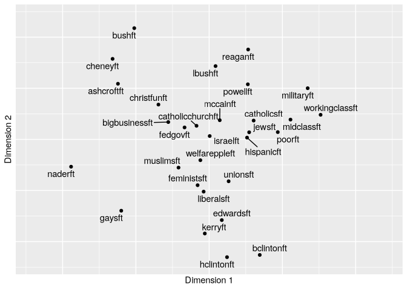
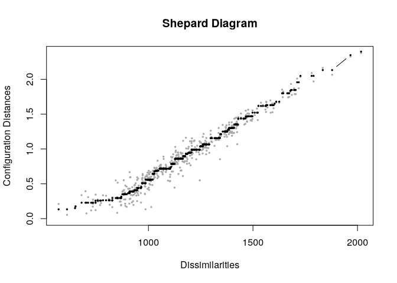
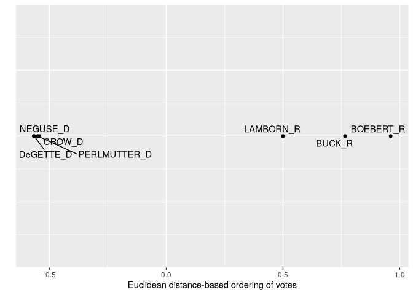
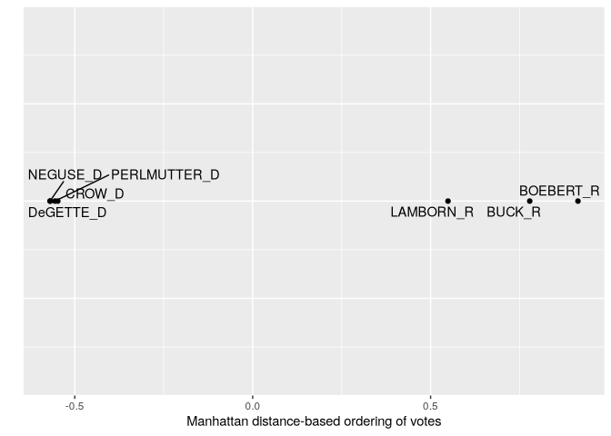
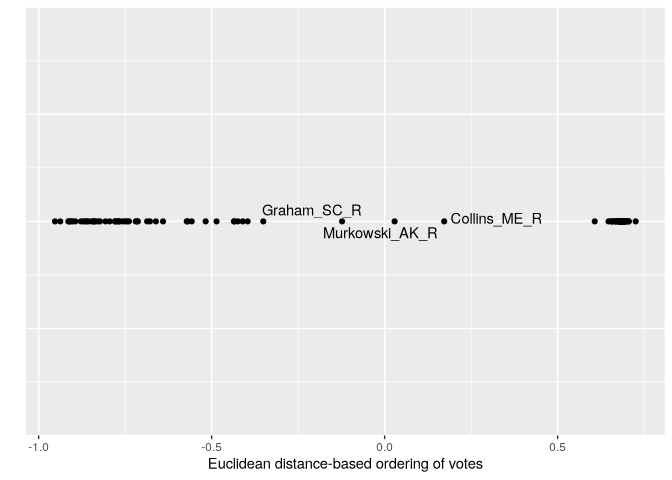
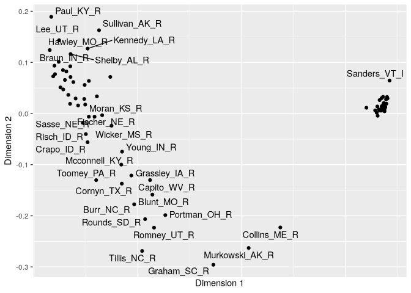
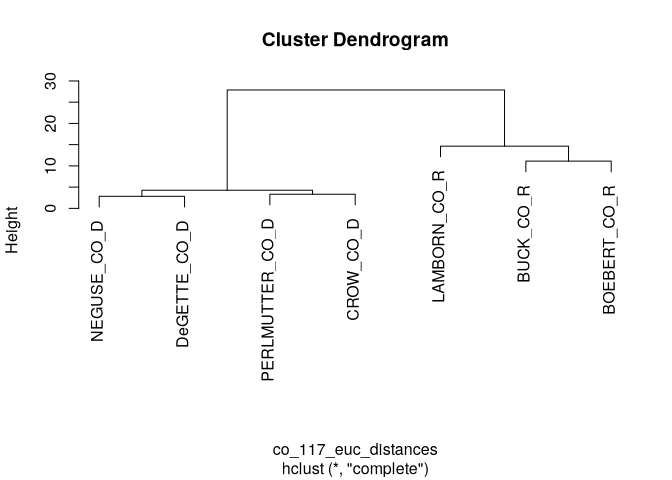
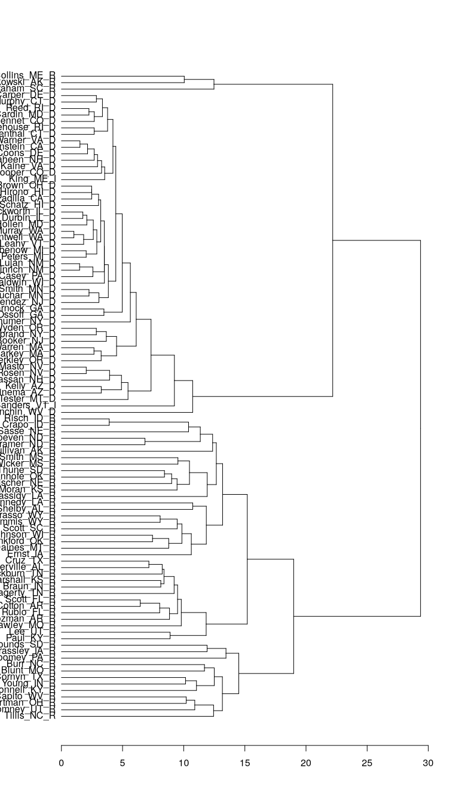

# Scaling and Clustering for Pattern Detection


``` r
options(paged.print = F, digits = 4)
```

``` r
library(tidyverse)
library(magrittr)
library(collapse)
library(ggrepel)
library(smacof)
microbenchmark <- microbenchmark::microbenchmark
fread <- data.table::fread
```

# Introduction to multidimensional scaling

The figure displays in two dimensions the patterns of feeling
thermometer scores toward political figures and groups in the 2004 ANES
survey; it is a typical ‘output’ of an MDS analysis, a two-dimensional
scatterplot, given the input of individual-level thermometer scores. The
figure shows the location of the subjects, where subjects grouped closer
together elicited more similar feelings from the electorate.


The MDS input data is a square matrix of dissimilarities, measures that
quantify the degree of difference between objects of political interest,
considered in pairs.

There are two basic varieties of MDS procedures: metric and nonmetric. A
metric MDS procedure makes interval-level assumptions about the input
dissimilarities, finding output distances that reflect the numeric score
dissimilarities in the input data. A nonmetric MDS procedure makes only
ordinal-level assumptions about the input dissimilarities. In effect the
input dissimilarity scores between objects of interest are rank ordered,
from least to most similar, and the algorithm finds an optimal
translation of the rank-ordered dissimilarities into distances.

This article describes nonmetric MDS.

Start with the construction of dissimilarity matrices.

# Euclidian and Manhattan distances

``` r
p=c(6,5,7)
q=c(1,2, 10)
r=c(2,5, 12)
(mat <- rbind(p, q, r))
```

      [,1] [,2] [,3]
    p    6    5    7
    q    1    2   10
    r    2    5   12

Euclidean distance:

$$\text{d}=\sqrt{(x_2 - x_1)^2+(y_2-y_1)^2 + \dots + (n_2-n_1)^2}$$

``` r
dist(mat)
```

          p     q
    q 6.557      
    r 6.403 3.742

Manhattan distance

$$\text{d}=|x_2 - x_1|+ |y_2-y_1| + \dots + |n_2-n_1|$$

``` r
dist(mat, method = "manhattan")
```

       p  q
    q 11   
    r  9  6

Instead of abstract points, in an MDS analysis, distance matrices are
created with measurements on political objects of interest — for
example, for feeling thermometers, the dimensions (like X and Y) are
each a survey respondent’s rating of a candidate, or for legislators,
the dimensions are the roll call votes. Give a matrix of dissimilarity,
the MDS algorithm translates the dissimiliarities into distances.

In a nonmetric MDS, the algorithm accounts for the ordinal arrangement
of the dissimilarities starting with “target distances” (or
“disparities”), the distances that the algorithm tries to reproduce in
the low-dimensional space. The target distances are a new distance
matrix, one that preserves the rank order of pairs of objects in their
similarity, but not necessarily the exact numerical value of the
original matrix of distances. The goal is to find a one- or
two-dimensional configuration of the points (as the output
visualization) where the actual distances between points closely
approximate these target distances. The algorithm focuses on preserving
the rank order of the dissimilarities, ensuring that objects perceived
as more similar remain closer together in the plot. The fit of the model
is evaluated using the function applied by the algorithm to find the
configuration, referred to as the “Stress function”, which measures the
degree of mismatch between the actual distances and the disparities,
with lower stress indicating a better fit.

# Scaling feelings toward political figures and groups

``` r
polfigures <- fread("data/poll_ft.csv")

(polfigures %<>% fselect(-gender, -campint, -fair, -prezapp, -libcon, -party, -partyid, 
                       -race, -conservatives, -abor, -educ) %>% as_tibble)
```

    # A tibble: 1,212 × 30
       bushft kerryft naderft cheneyft edwardsft lbushft hclintonft bclintonft
        <int>   <int>   <int>    <int>     <int>   <int>      <int>      <int>
     1     70      85       0       50        50      NA          0         15
     2     40      85      NA       40        70      60         70         70
     3    100      50      50      100        50     100         50         50
     4     50      60      60       40        70      60        100        100
     5    100       0      50       85         0     100          0          0
     6     60      30     100       15        30      50          0         85
     7     85      15      40       70        50      70         30         15
     8     50      70      85       60       100      70        100        100
     9     30      70      15       15        60      85         70         85
    10    100       0       0      100         0     100          0          0
    # ℹ 1,202 more rows
    # ℹ 22 more variables: powellft <int>, ashcroftft <int>, mccainft <int>,
    #   reaganft <int>, hispanicft <int>, christfunft <int>, catholicsft <int>,
    #   feministsft <int>, fedgovft <int>, jewsft <int>, liberalsft <int>,
    #   midclassft <int>, unionsft <int>, poorft <int>, militaryft <int>,
    #   bigbusinessft <int>, welfareppleft <int>, workingclassft <int>,
    #   gaysft <int>, catholicchurchft <int>, israelft <int>, muslimsft <int>

The candidates are currently on the columns, and survey respondent
raters are on the rows. The function requires that the ‘stimuli’, the
objects to be assessed for differences, appear on the rows.

``` r
t(polfigures[1:4, 1:4])
```

             [,1] [,2] [,3] [,4]
    bushft     70   40  100   50
    kerryft    85   85   50   60
    naderft     0   NA   50   60
    cheneyft   50   40  100   40

``` r
dist(t(polfigures[1:4, 1:4]))
```

             bushft kerryft naderft
    kerryft   69.64                
    naderft  100.00   98.15        
    cheneyft  22.36   78.42   84.85

The difference is adjusted by a factor of $\sqrt{\frac{n}{k}}$, where n
is the total possible number of comparisons, the total number of
‘dimensions’ or respondent ratings if there were no *NA* values. so, eg.
the distance between `kerryft` and `naderft` is not

``` r
sqrt((85-0)^2 + (50-50)^2 + (60-60)^2)
```

    [1] 85

but

``` r
sqrt((85-0)^2 + (50-50)^2 + (60-60)^2) * sqrt(4/3)
```

    [1] 98.15

Create the input distance matrix

``` r
dissimat <- dist(t(polfigures))
dissimat_matrix <- dissimat %>% as.matrix
ss(dissimat_matrix, 1:5, 1:5)
```

              bushft kerryft naderft cheneyft edwardsft
    bushft       0.0  1878.6    1429    782.9    1790.1
    kerryft   1878.6     0.0    1220   1678.8     651.4
    naderft   1429.5  1220.4       0   1251.3    1208.0
    cheneyft   782.9  1678.8    1251      0.0    1642.7
    edwardsft 1790.1   651.4    1208   1642.7       0.0

Using the **smacof** package ([Mair, De Leeuw, and Groenen
2022](https://whittkilburn.github.io/inpolr/ch7.html#ref-R-smacof)), the
`mds()` function will find a set of output coordinates for the input
dissimilarity matrix, for a given number of dimensions. The function
requires that we specify the input matrix (in this example, `dissimat`),
the number of dimensions (`ndim=`) and for a nonmetric MDS,
`type="ordinal"` .

The main result of the `mds()` function is the set of dimensional
positions of the feeling thermometers, which is stored as the
configuration of points, *nmds_results\$conf*.

``` r
nmds_results <- mds(dissimat, ndim = 2, type = "ordinal")
head(nmds_results$conf)
```

                   D1       D2
    bushft     1.0878 -0.51103
    kerryft   -0.9208 -0.02963
    naderft   -0.2673 -0.94219
    cheneyft   0.7874 -0.65896
    edwardsft -0.7895  0.08626
    lbushft    0.7167  0.04366

``` r
nmds1 <- qDF(nmds_results$conf)
head(nmds1)
```

                   D1       D2
    bushft     1.0878 -0.51103
    kerryft   -0.9208 -0.02963
    naderft   -0.2673 -0.94219
    cheneyft   0.7874 -0.65896
    edwardsft -0.7895  0.08626
    lbushft    0.7167  0.04366

``` r
ggplot(nmds1) +
  geom_point(aes(x=D2, y=D1)) +
  geom_text_repel(aes(x=D2, y=D1, label=row.names(nmds1))) +
  scale_y_continuous(limits = c(-1.2, 1.2))+
  scale_x_continuous(limits=c(-1.2, 1.2))+
  labs(x = "Dimension 1", y = "Dimension 2") +
  theme(axis.text.x = element_blank(), 
        axis.ticks.x = element_blank() )+ 
  theme(axis.text.y = element_blank(), 
        axis.ticks.y = element_blank() )
```



In interpreting MDS solutions, the key is the relative spacing of the
points, the direction or clustering of points — and not to focus
exclusively on the movement along the X and Y axes defined in the
graphic. Overall, the arrangement in Figure
[7.1](https://whittkilburn.github.io/inpolr/ch7.html#fig:mdsfig1)
reflects a familiar clustering of groups and figures associated with the
‘left’, ‘right’ and the Democratic and Republican parties, respectively.

## Assessing MDS model fit

The Stress statistic, often referred to as “Stress type 1” to
differentiate it from other measures is a standard for assessing how
well a visual configuration of the observations reflects the
dissimilarity input matrix ([Bartholomew et
al. 2008](https://whittkilburn.github.io/inpolr/ch7.html#ref-bartholomew2008)).
While not technically an average, it can be interpreted as the average
deviation between the disparities and the fitted distances in the
figure.

``` r
nmds_results
```


    Call:
    mds(delta = dissimat, ndim = 2, type = "ordinal")

    Model: Symmetric SMACOF 
    Number of objects: 30 
    Stress-1 value: 0.092 
    Number of iterations: 36 

The Stress measures how well the distances in the solution match the
dissimilarities from the input data. It ranges from 0 to 1, where lower
values indicate better fit. If the arrangement of the fitted distances
between the thermometers in the one- or two-dimensional space perfectly
reflects the rank=ordered distances of the thermometers in the input
matrix, then the Stress value would be 0, a perfect fit. From there,
some guidelines are .05 is a “good” fit, while .2 or higher is a “poor”
fit ([Bartholomew et
al. 2008](https://whittkilburn.github.io/inpolr/ch7.html#ref-bartholomew2008)).
There is a tradeoff between better fit through higher dimensionality
versus interpretability. In the example of the feeling thermometers, the
Stress value shows a good fit, which could be improved with an
additional dimension at the expense of parsimony.

## Shepard diagrams

``` r
plot(nmds_results, plot.type = "Shepard")
```



he diagram displays in gray points measurements on pairs of points, the
input dissimilarities on X and the fitted distances in the output on Y.
As would be expected from a Stress statistic of .092, the fit is not
perfect, but the model fits somewhat well, with points clustered along
the 45-degree line, although clearly for lower dissimilarities the fit
is worse. The spread of points at the lower left side of the graph
corresponds to the difficulty in scaling distances over two dimensions
for the points with low dissimilarity. With less spread, as
dissimilarity increases, fit improves. This contrast makes sense, given
that for social groups scaled relatively close together, the algorithm
was less successful in finding an optimal arrangement of the points,
compared to the more polarizing cluster of political figures toward the
edges of the output visualization.

The black points on the Shepard diagram represent the transformed
dissimilarities, or disparities, which serve as the target distances for
the MDS algorithm. These points reflect the idealized monotonic fit,
preserving the rank order of the original dissimilarities. Notice that,
from left to right, the black points either increase or remain constant,
but never decrease, ensuring the monotonic relationship. Similar to the
imaginary 45-degree line in metric MDS, the grey points, which represent
the actual distances in the low-dimensional solution, should lie as
close as possible to the black points for a good fit.

# Scaling votes

## Scaling roll call votes in the US Congress

[source](https://voteview.com/data)

``` r
HS117_votes <- fread("data/HS117_votes.csv")
HS117_house <- fread("data/house_memb_117.csv")
HS117_senate <- fread("data/senate_memb_117.csv")
HS117_members <- rowbind(HS117_house, HS117_senate, fill = T)
```

``` r
HS117_votes_raw <- fread("data/HS117_votes_raw.csv")
HS117_votes <- fselect(HS117_votes_raw, chamber, rollnumber, icpsr, cast_code)
```

Next we recode the numeric values for the ‘yeas’, ‘nays’, present, and
absent votes. The ‘nays’ are scored at 0, ‘yeas’ at 1, and to make it
easier to recall, 5 for present and 10 for absent.

``` r
HS117_votes %<>% fmutate(cast_code = case_when(
    cast_code==6 ~ 0,
    cast_code==1 ~ 1,
    cast_code==7 ~ 5,
    cast_code==9 ~ 10))
```

``` r
table(HS117_votes$cast_code)
```


         0      1      5     10 
    166179 346003     98  11964 

The data table contains demographic information about each member, as
well as an ideology score ([K. T. Poole and Rosenthal
2006](https://whittkilburn.github.io/inpolr/ch7.html#ref-poole2006)).
The key field in the members’ data is a unique identifier for each
member, *icpsr*. The member data needs to be merged with the votes. We
want, for each row of votes in *HS117_votes*, to have the member
information appended as additional columns matched to *icpsr*.

``` r
hs_memb_votes_117 <- 
  HS117_members %>% 
  fselect(icpsr, bioname, state_abbrev, party_code) %>% 
  right_join(HS117_votes, by = "icpsr") %>% 
  fselect(chamber, bioname, party_code, state_abbrev, 
          cast_code, rollnumber, icpsr)
```

The Voteview data includes mock votes from public positions taken by
presidents. Inspect the dataset to observe the presidents in the first
few rows. We

``` r
hs_memb_votes_117 %<>% fsubset(state_abbrev %!=% "USA")
```

``` r
h_memb_votes_117 <- fsubset(hs_memb_votes_117, chamber == "House", -chamber)
```

We want to limit the data to just those representatives serving a full
term. So we filter the data to all representatives with exactly 996
rows:

``` r
h_memb_votes_117 %<>% 
  fgroup_by(bioname) %>% 
  fmutate(group_size = fnobs(bioname)) %>% 
  ungroup() %>% 
  fsubset(group_size %==% 996)
```

To limit the data and make it more manageable for learning MDS, we
subset it to Colorado. Also we split the name into two columns.

``` r
co_h_votes_117 <- 
  fsubset(h_memb_votes_117, state_abbrev %==% "CO", -group_size)
co_h_votes_117 %<>%
  separate(bioname, c("last_name", "first"), sep=", ")
```

``` r
co_h_votes_117 %>% fsubset(party_code %!=% "Republican")
```

    # A tibble: 3,984 × 7
       last_name  first party_code state_abbrev cast_code rollnumber icpsr
       <chr>      <chr> <chr>      <chr>            <dbl>      <int> <int>
     1 PERLMUTTER Ed    Democratic CO                   1          1 20705
     2 PERLMUTTER Ed    Democratic CO                   1          2 20705
     3 PERLMUTTER Ed    Democratic CO                   1          3 20705
     4 PERLMUTTER Ed    Democratic CO                   1          4 20705
     5 PERLMUTTER Ed    Democratic CO                   1          5 20705
     6 PERLMUTTER Ed    Democratic CO                   0          6 20705
     7 PERLMUTTER Ed    Democratic CO                   1          7 20705
     8 PERLMUTTER Ed    Democratic CO                   1          8 20705
     9 PERLMUTTER Ed    Democratic CO                   0          9 20705
    10 PERLMUTTER Ed    Democratic CO                   0         10 20705
    # ℹ 3,974 more rows

Create a name variable with state and party, and change the party code
to text.

``` r
co_h_votes_117 %<>%
  fmutate(party_code = case_when(
    party_code == "Democratic" ~ "D", 
    party_code == "Republican"  ~ "R"))  %>%
  unite(name, c("last_name", "state_abbrev", "party_code")) %>% 
  fselect(-first, -icpsr)
```

``` r
microbenchmark(
  co = co_h_votes_117 %>%
    fcount(cast_code) %>%
    fmutate(prop = N / sum(N)),
  td = co_h_votes_117 %>%
    count(cast_code) %>%
    mutate(prop. = n / sum(n))
)
```

    Unit: microseconds
     expr    min      lq    mean  median      uq    max neval
       co   57.8   64.51   84.04   91.01   96.29  302.5   100
       td 2474.1 2553.62 2690.64 2585.47 2652.46 7895.4   100

Votes other than yeas or nays. These cannot be ordinally related to yeas
or nays.

``` r
co_h_votes_117 %>% 
  fcount(cast_code) %>% 
  fmutate(prop = N / sum(N))
```

    # A tibble: 4 × 3
      cast_code     N     prop
          <dbl> <int>    <dbl>
    1         0  2284 0.328   
    2         1  4571 0.656   
    3        10   116 0.0166  
    4         5     1 0.000143

They represent about 1.6 percent of the total. Counting abscences by
Representative:

``` r
collap(co_h_votes_117, ~ name, FUN = \(x) fsum(x == 10), cols = "cast_code") %>% 
  frename(summary_absences = cast_code) %>% roworder(-summary_absences)
```

    # A tibble: 7 × 2
      name            summary_absences
      <chr>                      <int>
    1 BUCK_CO_R                     55
    2 BOEBERT_CO_R                  24
    3 LAMBORN_CO_R                  20
    4 CROW_CO_D                      6
    5 DeGETTE_CO_D                   5
    6 PERLMUTTER_CO_D                5
    7 NEGUSE_CO_D                    1

``` r
collap(co_h_votes_117, ~ name, FUN = \(x) fsum(x == 5), cols = "cast_code") %>% 
  frename(summary_absences = cast_code) %>% roworder(-summary_absences)
```

    # A tibble: 7 × 2
      name            summary_absences
      <chr>                      <int>
    1 BOEBERT_CO_R                   1
    2 BUCK_CO_R                      0
    3 CROW_CO_D                      0
    4 DeGETTE_CO_D                   0
    5 LAMBORN_CO_R                   0
    6 NEGUSE_CO_D                    0
    7 PERLMUTTER_CO_D                0

``` r
microbenchmark(
  td = co_h_votes_117 %>%  
  group_by(name) %>%
  summarize(summary_absences = sum(cast_code == 10, na.rm = TRUE)) %>%
  arrange(desc(summary_absences)),
  co = collap(co_h_votes_117, ~ name, FUN = \(x) fsum(x == 10), cols = "cast_code") %>% 
  frename(summary_absences = cast_code) %>% roworder(-summary_absences)
)
```

    Unit: microseconds
     expr  min     lq mean median     uq    max neval
       td 2640 2709.3 2824 2762.2 2818.5 6850.7   100
       co  206  244.3  274  267.1  293.9  413.4   100

Convert the missing votes to `NA`.

``` r
co_na_h_votes_117 <- co_h_votes_117 %>%
  fmutate(cast_code = case_when(
    cast_code %in% c(5, 10) ~ NA,
    TRUE ~ cast_code))
```

Next we pivot the data to wide format.

``` r
microbenchmark(
  td = co_na_h_votes_117 %>%
  pivot_wider(values_from = cast_code, names_from = rollnumber),
  co = co_na_h_votes_117 %>% 
  pivot("name", "cast_code", "rollnumber", how = "w")
)
```

    Unit: microseconds
     expr    min     lq   mean median     uq     max neval
       td 6910.1 7149.3 8225.4 7312.5 8287.4 14577.8   100
       co  192.9  215.8  292.4  264.2  304.8   934.7   100

``` r
co_na_h_votes_117_wide <- co_na_h_votes_117 %>% 
  pivot("name", "cast_code", "rollnumber", how = "w") %>% 
  column_to_rownames(var = "name")
```

Note that the `name` column must be moved to rownames for the distance
calculation.

Compare the two different distance calculations.

``` r
(co_117_euc_distances <- dist(co_na_h_votes_117_wide, method = "euclidean"))
```

                    LAMBORN_CO_R PERLMUTTER_CO_D BUCK_CO_R CROW_CO_D NEGUSE_CO_D
    PERLMUTTER_CO_D       24.746                                                
    BUCK_CO_R             12.960          26.880                                
    CROW_CO_D             24.551           3.335    26.755                      
    NEGUSE_CO_D           24.778           3.885    26.882     3.755            
    BOEBERT_CO_R          14.645          27.845    11.121    27.785      27.880
    DeGETTE_CO_D          24.850           3.893    26.880     4.266       2.837
                    BOEBERT_CO_R
    PERLMUTTER_CO_D             
    BUCK_CO_R                   
    CROW_CO_D                   
    NEGUSE_CO_D                 
    BOEBERT_CO_R                
    DeGETTE_CO_D          27.831

``` r
(co_117_man_distances <- dist(co_na_h_votes_117_wide, method = "manhattan"))
```

                    LAMBORN_CO_R PERLMUTTER_CO_D BUCK_CO_R CROW_CO_D NEGUSE_CO_D
    PERLMUTTER_CO_D      612.371                                                
    BUCK_CO_R            167.974         722.526                                
    CROW_CO_D            602.734          11.123   715.842                      
    NEGUSE_CO_D          613.945          15.091   722.630    14.099            
    BOEBERT_CO_R         214.475         775.354   123.686   772.029     777.291
    DeGETTE_CO_D         617.499          15.152   722.526    18.201       8.048
                    BOEBERT_CO_R
    PERLMUTTER_CO_D             
    BUCK_CO_R                   
    CROW_CO_D                   
    NEGUSE_CO_D                 
    BOEBERT_CO_R                
    DeGETTE_CO_D         774.552

Here, Boebert is further away from the Democrats than Buck is.

Because the data includes NA values, the Manhattan distances are not
whole numbers, distances with the scaling factor applied to each
calculation. If calculated without the scaling factor, a Manhattan
distance has an interesting interpretation. Since the Manhattan distance
sums the absolute difference between each roll call vote scored 0 ‘nay’
and 1 ‘yea’, the unadjusted Manhattan distance counts the number of
votes where two legislators differ. If two legislators cast a different
‘yea’ or ‘nay’ on 300 votes, their Manhattan distance would be 300. We
can consider only those votes for which all members voted in order to
get whole numbers.

``` r
microbenchmark(
  td = co_na_h_votes_117_wide %>%
  select_if(~ all(!is.na(.))),
  co = co_na_h_votes_117_wide %>% 
  gv(fnobs(co_na_h_votes_117_wide) == fnrow(co_na_h_votes_117_wide))
)
```

    Unit: microseconds
     expr       min        lq     mean    median        uq      max neval
       td 288187.20 296859.80 307048.1 300674.48 307439.68 440329.1   100
       co     43.58     47.13     67.1     66.34     80.53    228.5   100

``` r
(co_117_man_comp_distances <- co_na_h_votes_117_wide %>% 
  gv(fnobs(co_na_h_votes_117_wide) == fnrow(co_na_h_votes_117_wide)) %>%
  dist(method = "manhattan"))
```

                    LAMBORN_CO_R PERLMUTTER_CO_D BUCK_CO_R CROW_CO_D NEGUSE_CO_D
    PERLMUTTER_CO_D          554                                                
    BUCK_CO_R                146             644                                
    CROW_CO_D                545               9       639                      
    NEGUSE_CO_D              556              12       644        13            
    BOEBERT_CO_R             188             694       110       693         696
    DeGETTE_CO_D             558              12       644        17           8
                    BOEBERT_CO_R
    PERLMUTTER_CO_D             
    BUCK_CO_R                   
    CROW_CO_D                   
    NEGUSE_CO_D                 
    BOEBERT_CO_R                
    DeGETTE_CO_D             694

The distances, in whole numbers, measure the number of votes differing
between each legislator.

We will compare a one-dimensional representation of the voting
similarity between the Euclidean and the unscaled up whole number
Manhattan distances.

``` r
co_h_117_euc_mds <- mds(co_117_euc_distances, ndim = 1, type = "ordinal")
co_h_117_euc_mds$stress
```

    [1] 0.002742

``` r
co_h_117_man_mds <- mds(co_117_man_distances, ndim = 1, type = "ordinal")
co_h_117_man_mds$stress
```

    [1] 0.002522

Stress indicates a good 1D fit. Prepare the results for plotting.

``` r
co_mds_df_euc <- qDF(co_h_117_euc_mds$conf) %>% 
  rownames_to_column(var = "name") %>% 
  fmutate(name = str_remove_all(name, "_CO"))
co_mds_df_man <- qDF(co_h_117_man_mds$conf) %>% 
  rownames_to_column(var = "name") %>% 
  fmutate(name = str_remove_all(name, "_CO"))
```

``` r
ggplot(co_mds_df_euc) +
  geom_point(aes(x = D1, y = 0)) +
  geom_text_repel(aes(x = D1, y = 0, label = name), max.overlaps = 7) +
  labs(x = "Euclidean distance-based ordering of votes", y = " ") +
  theme(
    axis.text.y = element_blank(),
    axis.ticks.y = element_blank()
  )
```



``` r
ggplot(co_mds_df_man) +
  geom_point(aes(x = D1, y = 0)) +
  geom_text_repel(aes(x = D1, y = 0, label = name), max.overlaps = 7) +
  labs(x = "Manhattan distance-based ordering of votes", y = " ") +
  theme(
    axis.text.y = element_blank(),
    axis.ticks.y = element_blank()
  )
```



## Scaling votes in the Senate

``` r
microbenchmark(
  co = hs_memb_votes_117 %>%
    fsubset(chamber %==% "Senate", -chamber),
  td = hs_memb_votes_117 %>%
    filter(chamber == "Senate") %>%
    select(-chamber)
)
```

    Unit: microseconds
     expr    min     lq  mean median    uq    max neval
       co  901.6  957.2  1641   1053  1586   7009   100
       td 7112.0 7443.5 10190   7647 10150 150041   100

``` r
s_memb_votes_117 <- hs_memb_votes_117 %>% 
  fsubset(chamber %==% "Senate", -chamber) %>% 
  fsubset(!is.na(bioname))
```

The data contains two votes from Kamela Harris as VP and Kelly Loeffler
as a temporary appointee. We remove them.

``` r
s_memb_votes_117 %<>% 
  fsubset(bioname %!in% c("LOEFFLER, Kelly", "HARRIS, Kamala Devi"))
```

``` r
s_memb_votes_117 %<>%
  separate(bioname, c("last_name", "first"), sep = ", ") %>%
  fmutate(
    last_name = str_to_title(last_name),
    party_code = case_when(
      party_code == "Democratic" ~ "D",
      party_code == "Republican" ~ "R",
      party_code == "Independent" ~ "I"
    )
  ) %>%
  unite(name, c("last_name", "state_abbrev", "party_code")) %>%
  fselect(-first, -icpsr) %>%
  fmutate(cast_code = case_when(
    cast_code %in% c(5, 10) ~ NA,
    TRUE ~ cast_code
  ))
```

    Warning: Expected 2 pieces. Additional pieces discarded in 2847 rows [34159, 34160,
    34161, 34162, 34163, 34164, 34165, 34166, 34167, 34168, 34169, 34170, 34171,
    34172, 34173, 34174, 34175, 34176, 34177, 34178, ...].

``` r
s_memb_votes_117_wide <- s_memb_votes_117 %>% 
  pivot("name", "cast_code", "rollnumber", how = "w") %>% 
  column_to_rownames(var = "name")
```

``` r
s_117_euc_distances <- dist(s_memb_votes_117_wide, method = "euclidean")
```

``` r
as.matrix(s_117_euc_distances) %>% ss(1:5, 1:5)
```

                    Tuberville_AL_R Shelby_AL_R Murkowski_AK_R Sullivan_AK_R
    Tuberville_AL_R           0.000       8.811          22.54         12.83
    Shelby_AL_R               8.811       0.000          21.22         12.41
    Murkowski_AK_R           22.538      21.216           0.00         19.75
    Sullivan_AK_R            12.832      12.408          19.75          0.00
    Sinema_AZ_D              28.611      27.772          18.01         26.13
                    Sinema_AZ_D
    Tuberville_AL_R       28.61
    Shelby_AL_R           27.77
    Murkowski_AK_R        18.01
    Sullivan_AK_R         26.13
    Sinema_AZ_D            0.00

``` r
s_117_euc_mds <- mds(s_117_euc_distances, ndim = 1, type = "ordinal")
s_117_euc_mds$stress
```

    [1] 0.0243

This indicates a good fit.

``` r
s_117_euc_mds <- qDF(s_117_euc_mds$conf) %>% 
  rownames_to_column(var = "name")
```

``` r
ggplot(s_117_euc_mds) +
  geom_point(aes(x = D1, y = 0)) +
  geom_text_repel(aes(x = D1, y = 0, label = name)) +
  labs(x = "Euclidean distance-based ordering of votes", y = " ") +
    theme(axis.text.y = element_blank(), 
           axis.ticks.y = element_blank())
```



Now consider a 2-dim representation

``` r
s_117_euc_mds2 <- mds(s_117_euc_distances, ndim = 2, type = "ordinal")
s_117_euc_mds2$stress
```

    [1] 0.02038

The fit is marginally better.

``` r
s_117_euc_mds2 <- qDF(s_117_euc_mds2$conf) %>% 
  rownames_to_column(var = "name")
```

``` r
ggplot(s_117_euc_mds2) +
  geom_point(aes(x = D1, y = D2)) +
  geom_text_repel(aes(x = D1, y = D2, label = name)) +
  labs(x = "Dimension 1", y = "Dimension 2") +
    theme(axis.text.x = element_blank(), 
          axis.ticks.x = element_blank())
```



The two-dimensional results clearly show the same left to right
difference observable on Dimension 1, with Collins, Murkowski, and
Graham having the more centrist voting record along it. The two Senators
Hawley and Sanders anchor both ends of the dimension. And of course the
close clustering of Democrats reveals a high degree of party unity in
voting, perhaps to be expected given their slim majority. And like the
first, the second dimension shows distinct differences among
Republicans. On this second dimension, Graham anchors the bottom of the
figure, followed by Tillis and Murkowski. Perhaps this dimension
reflects a willingness to vote against the party leadership.

# Clustering feelings and votes

Cluster analysis relies on distance metrics as a data input. Unlike MDS,
however, rather than uncover a dimensional structure of the data, the
purpose is to identify clusters or groups of similar political
phenomena. The typical end product of a cluster analysis is a specific
visualization, a dendrogram, which displays the formation of clusters in
a hierarchy of similarity.

A common approach to cluster analysis is hierarchical agglomerative
clustering (HAC). The ‘agglomerative’ term means that the clustering
process is bottom-up, starting with the maximal number of clusters, then
ending up with all observations combined into one cluster. The HAC
algorithm proceeds in a series of steps:

1.  each observation begins as its own cluster
2.  the algorithm merges the two closest clusters
3.  clusters become larger and are merged until all observations belong
    to a single cluster

The process of forming clusters yields overarching, ‘hierarchical’
clusters as the name implies. At each step of the clustering process,
the input distance matrix is reduced and recalculated among the
clusters. The rules are often one of the following: “Single linkage”:
the distance between the two closest points in different clusters,
“Complete linkage”: the distance between the two farthest points in
different clusters, or “Average linkage”: the average distance between
all pairs of points in two clusters. The rule for combining clusters
determines how clusters are formed, so the results of any cluster
analysis are sensitive to the type of linkage used

The default linking method of `hclust` is Complete linkage

``` r
(hac <- hclust(co_117_euc_distances))
```


    Call:
    hclust(d = co_117_euc_distances)

    Cluster method   : complete 
    Distance         : euclidean 
    Number of objects: 7 

``` r
plot(hac)
```



``` r
(hac_s <- hclust(s_117_euc_distances))
```


    Call:
    hclust(d = s_117_euc_distances)

    Cluster method   : complete 
    Distance         : euclidean 
    Number of objects: 100 

``` r
hac_s_d <- as.dendrogram(hac_s)
dendextend::set(hac_s_d, "labels_cex", .2)
```

    'dendrogram' with 2 branches and 100 members total, at height 29.37 

``` r
dendextend::plot_horiz.dendrogram(hac_s_d)
```


